# NOVA – alle Funktionen erklärt

Hier steht jede Funktion von NOVA, Seite für Seite, in einfachen Worten.
Die Bilder stammen aus der Vorschau mit Beispieldaten (die Spiele sind nur Beispiele).

**Inhalt:**
[Überall](#1-überall-in-der-app) ·
[Start](#2-startseite) ·
[Bibliothek](#3-bibliothek) ·
[Spiel-Seite](#4-spiel-seite) ·
[Sammlungen](#5-sammlungen) ·
[Statistik](#6-statistik) ·
[Erfolge](#7-erfolge) ·
[Wunschliste](#8-wunschliste) ·
[Aufräumen](#9-aufräumen) ·
[Einstellungen](#10-einstellungen) ·
[Strg+K](#11-befehlspalette-strgk) ·
[Würfel](#12-würfel-was-soll-ich-spielen) ·
[Big Picture](#13-big-picture-fürs-sofa) ·
[Overlay](#14-mini-overlay-über-dem-spiel) ·
[Dock](#15-schnellstart-dock) ·
[Tray](#16-symbol-neben-der-uhr-tray) ·
[Tastenkürzel](#17-alle-tastenkürzel) ·
[Themes](#18-themes) ·
[Installer](#19-der-installer) ·
[Noch nicht drin](#20-was-noch-nicht-drin-ist)

---

## 1. Überall in der App

**Startanimation.** Beim Öffnen leuchtet der NOVA-Stern im Sternenhimmel auf, mit Partikeln und Klang. Danach fliegt das Logo nach oben in die Titelleiste. Abschaltbar.

**Titelleiste (ganz oben):**
- **Suchfeld „Suchen oder starten …“** – öffnet die Befehlspalette (siehe Abschnitt 11).
- **Zurück-Pfeil** – erscheint, sobald du eine Seite weiter geklickt hast.
- **Grüne „Läuft“-Anzeige** – zeigt, welches Spiel gerade läuft, mit laufender Uhr. Klick öffnet das Spiel.
- **Update-Anzeige** – erscheint, wenn eine neue NOVA-Version da ist.
- **Lautsprecher** – alle Töne stumm schalten.
- **Farbiger Kreis mit Buchstabe** – dein Profil. Klick: Profil wechseln oder neues anlegen.
- **Minimieren, Maximieren, Schließen.** Schließen schickt NOVA (je nach Einstellung) nur in den Infobereich neben der Uhr. Dort misst NOVA weiter die Spielzeit.

**Seitenleiste (links):** Start, Bibliothek, Sammlungen, Statistik, Erfolge, Wunschliste, Aufräumen. Darunter deine eigenen Sammlungen. Unten der Knopf **„Was soll ich spielen?“**, **Big Picture** und **Einstellungen**. Mit dem Doppelpfeil ganz unten klappst du die Leiste schmal.

**Rechtsklick auf ein Spiel** (überall: Kachel, Liste, Dock) öffnet ein Menü:
Spielen bzw. Beenden · Anzeigen · Favorit · Im Dock · Status · Zu Sammlung hinzufügen · Installationsordner öffnen · Bilder neu laden · Ausblenden · Entfernen.
„Entfernen“ löscht nur den Eintrag in NOVA (samt Spielzeit), nicht das Spiel selbst.

**Spielkarte:** Klick öffnet die Spiel-Seite, **Doppelklick startet**. Beim Überfahren kippt die Karte leicht in 3D und zeigt einen runden Spielen-Knopf. Ein grünes Schild zeigt „Läuft gerade“, ein Herz zeigt Favoriten.

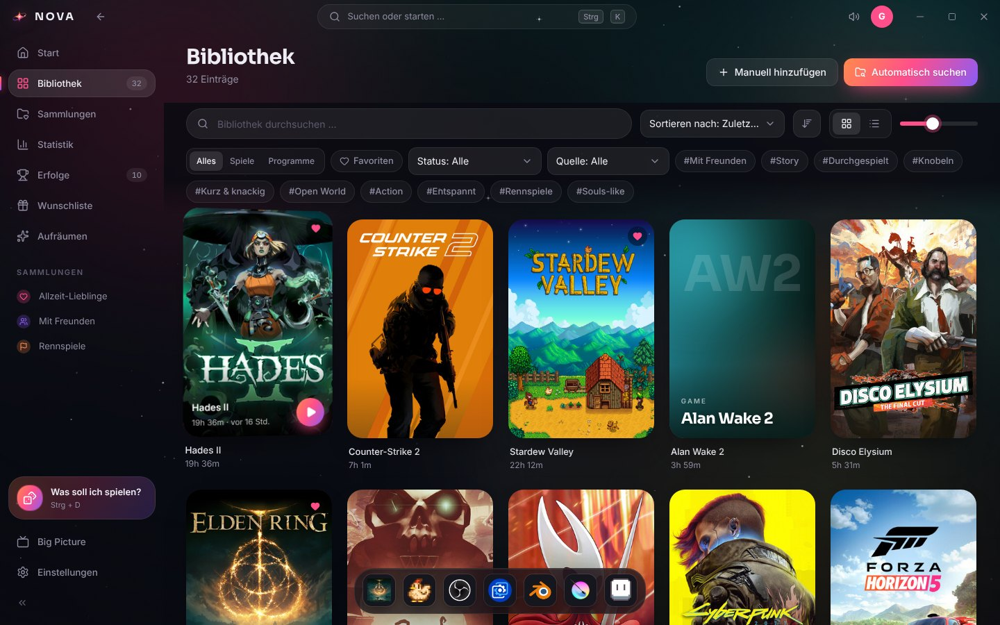

**Ziehen und Ablegen:** Zieh eine `.exe`, eine Verknüpfung oder einen ganzen Ordner einfach ins Fenster. NOVA nimmt sie sofort auf. Doppelte werden übersprungen.

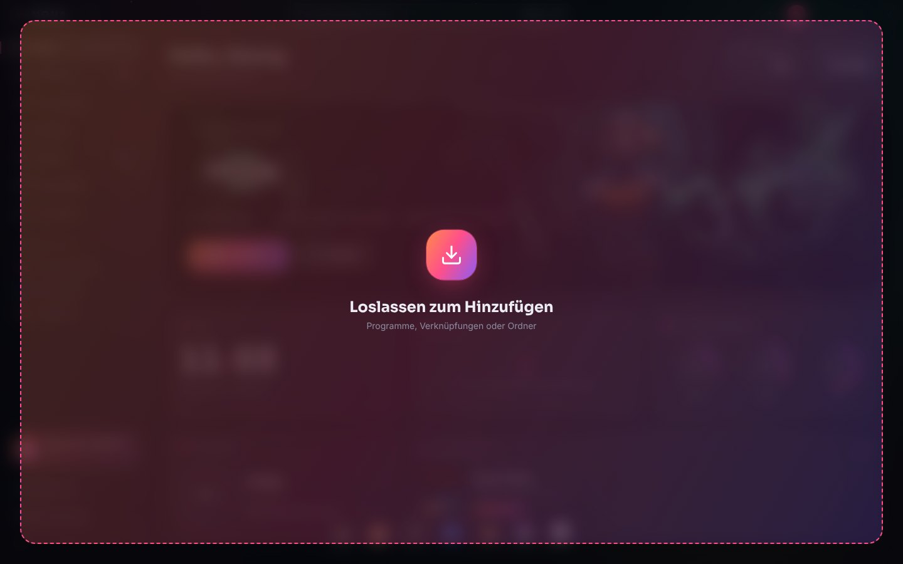

**Lebendiger Hintergrund:** Der Hintergrund färbt sich passend zum Spiel, über dem deine Maus gerade ist. Dazu leichter Sternenhimmel, der der Maus folgt.

**Echte Bilder für jedes Spiel – ohne Anmeldung:** Cover, großes Hintergrundbild, Logo und Icon lädt NOVA selbst.
- **Steam-Spiele** bekommen alles direkt von Steam.
- **Epic-, GOG- und eigene Spiele** sucht NOVA per Name bei Steam und nimmt dessen Bilder.
- **Icons** kommen aus der Programmdatei – scharf, auch für Programme wie OBS, Blender oder Discord. Sie erscheinen im Dock, im Overlay und bei Programmen anstelle eines Covers.
- Fehlt etwas, versucht NOVA es beim Start von selbst noch einmal (höchstens alle 3 Tage).
- Gibt es ein Spiel bei Steam gar nicht (z. B. Alan Wake 2), malt NOVA ein farbiges Ersatz-Cover – oder du holst dir mit einem kostenlosen SteamGridDB-Schlüssel noch mehr Bilder.

**Spielzeit messen – ganz automatisch:**
- NOVA schaut alle paar Sekunden, welche Spiele laufen. Das klappt auch, wenn du das Spiel direkt über Steam startest, solange NOVA offen ist oder unten neben der Uhr sitzt.
- Sitzungen unter 10 Sekunden zählen nicht.
- NOVA speichert jede Minute zwischen. Stürzt der PC ab, ist fast nichts verloren.
- Startest du ein Spiel aus NOVA, kommt zuerst das **Start-Ritual** (kurze Kino-Animation, per Klick überspringbar). Danach minimiert sich NOVA, wenn du das willst.
- Beim Beenden kommt die Meldung „… beendet – 1 Std. 20 Min. gespielt“.

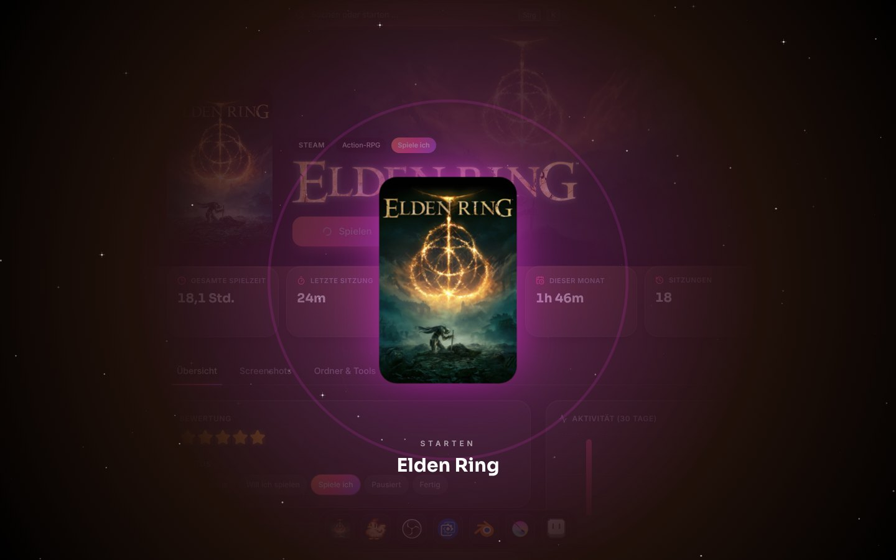

**Datensicherung im Hintergrund:** NOVA sichert deine Bibliothek einmal am Tag automatisch (die letzten 10 Sicherungen bleiben). Ist die Datenbank einmal kaputt, holt NOVA sich selbst die letzte gute Sicherung zurück.

---

## 2. Startseite

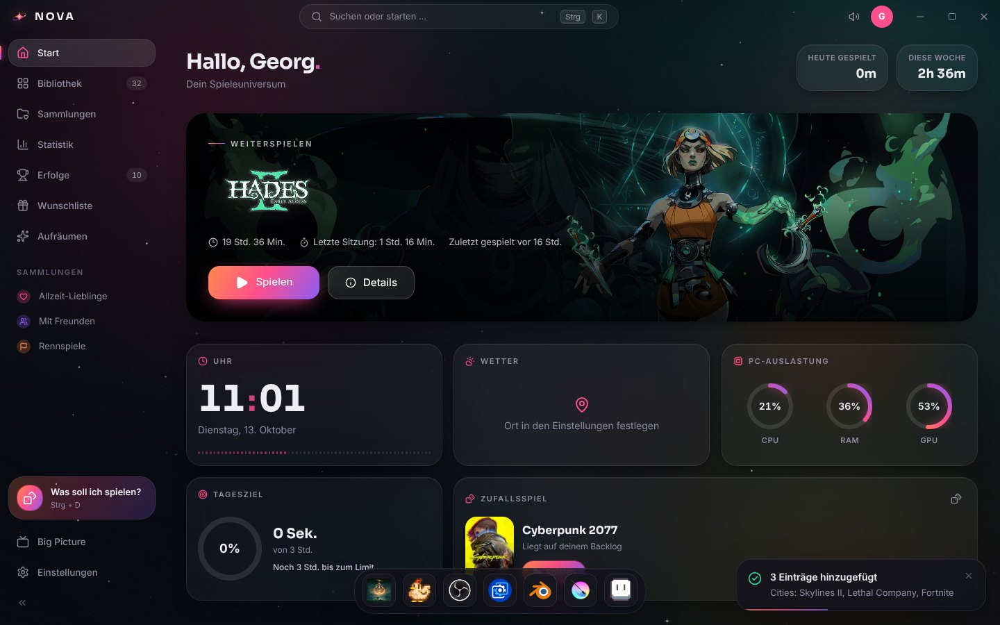

- **Begrüßung** passend zur Uhrzeit („Guten Morgen, Georg“).
- **„Heute gespielt“ und „Diese Woche“** – zählen live mit, während du spielst.
- **Großer Bereich „Weiterspielen“** – das laufende oder zuletzt gespielte Spiel mit Spielzeit, letzter Sitzung, Knopf **Spielen** (bzw. Beenden) und **Details**.
- **Widgets:**
  - **Uhr** mit Datum.
  - **Wetter** – Temperatur, gefühlte Temperatur, Höchst-/Tiefstwert, animiertes Symbol. Den Ort stellst du in den Einstellungen ein. Ohne Anmeldung, ohne Schlüssel.
  - **PC-Auslastung** – CPU, Arbeitsspeicher und Grafikkarte in Prozent. Gelb ab 75 %, rot ab 90 %.
  - **Tagesziel** – Ring, wie viel du heute gespielt hast. Entweder als **Ziel** („Noch 40 Min. bis zum Ziel“) oder als **Limit** („Limit erreicht – Zeit für eine Pause?“).
  - **Zufallsspiel** – schlägt dir ein Spiel mit Grund vor. Würfel-Knopf für einen neuen Vorschlag.
- **Regale:** „Kürzlich gespielt“, „Favoriten“ und „Neu hinzugefügt“. Mit Pfeilen blättern.

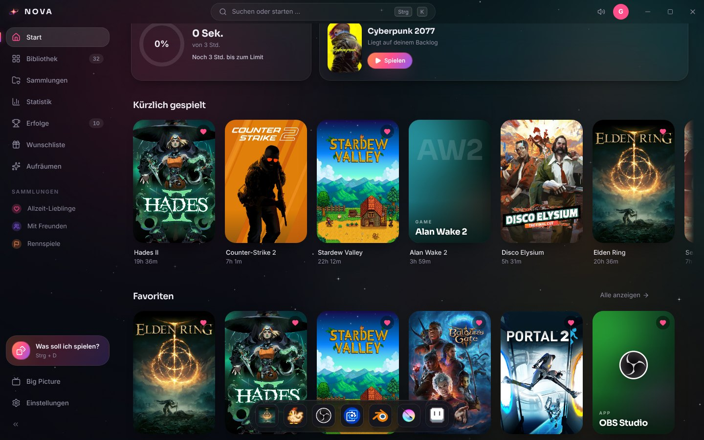

Ist die Bibliothek noch leer, steht hier stattdessen **„Willkommen bei NOVA“** mit dem Knopf **„Bibliothek automatisch füllen“**.

---

## 3. Bibliothek

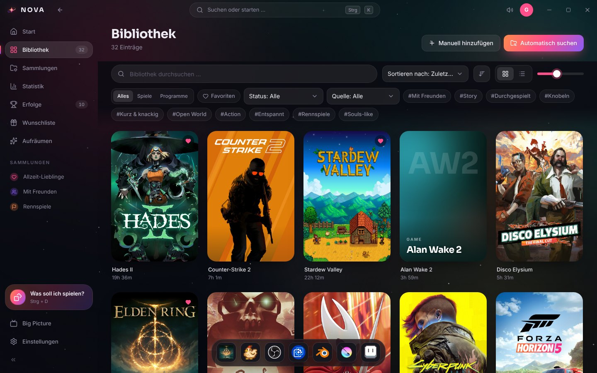

**Oben rechts:**
- **„Manuell hinzufügen“** – ein Programm, eine Verknüpfung oder einen Link (z. B. `steam://rungameid/620`) von Hand eintragen.
- **„Automatisch suchen“** – öffnet den Such-Assistenten (unten).

**Suche:** Tippe einfach los. Die Suche ist großzügig: „bg3“ findet „Baldur's Gate 3“, und Wortanfänge genügen („star“ findet „Stardew Valley“). Sie sucht auch in Kategorien und Tags.

**Sortieren:** Zuletzt gespielt, Name, Spielzeit, Bewertung oder Hinzugefügt – auf- oder absteigend.

**Ansicht:** Kacheln oder Liste. Bei Kacheln stellst du die Größe mit dem Schieberegler ein. NOVA merkt sich alles.

**Filter:** Alles / Spiele / Programme · nur Favoriten · Status (Will ich spielen, Spiele ich, Pausiert, Fertig) · Quelle (Steam, Epic, GOG, Startmenü, Ordner, Manuell) · deine häufigsten Tags · ausgeblendete Einträge zeigen · „Filter zurücksetzen“.

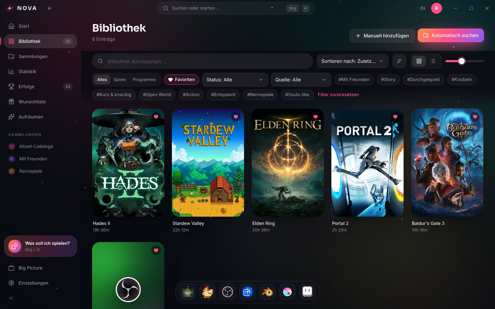
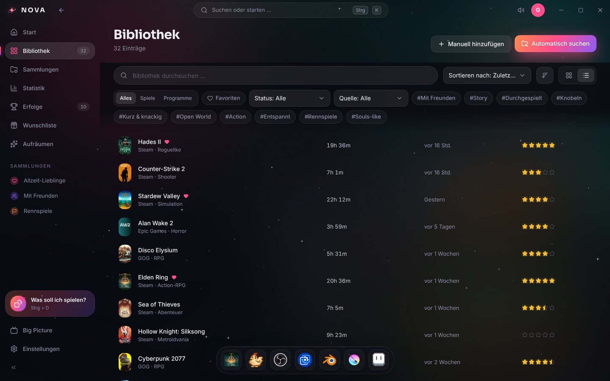

**Auch riesige Bibliotheken bleiben flüssig.** NOVA zeichnet nur die Karten, die gerade sichtbar sind.

### Bibliothek automatisch füllen

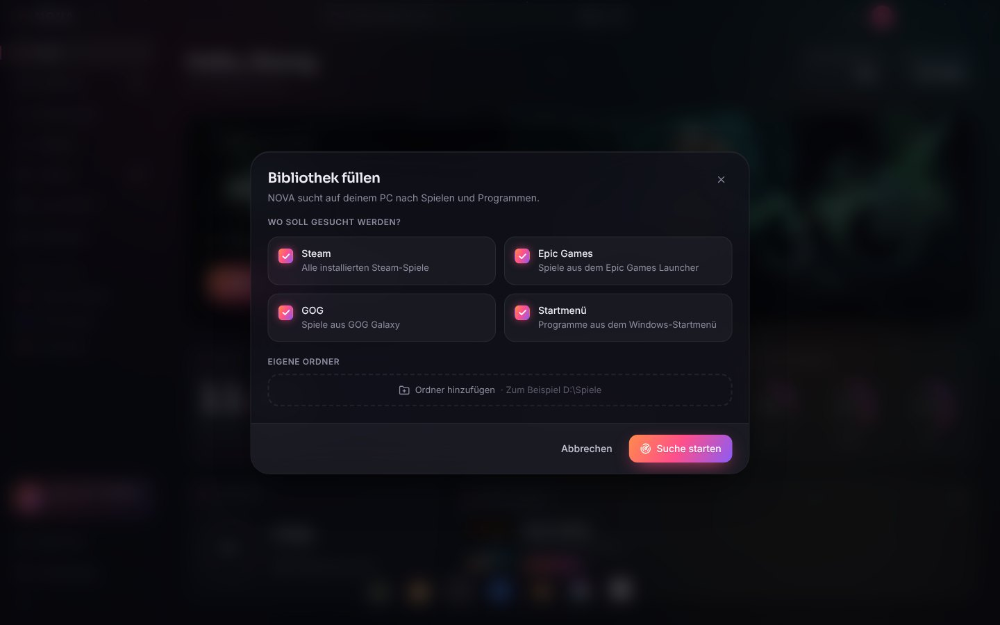

1. **Wo soll gesucht werden?** Häkchen bei Steam, Epic Games, GOG, Startmenü. Dazu eigene Ordner (z. B. `D:\Spiele`) – jeder Unterordner wird ein Spiel, NOVA sucht die richtige `.exe` selbst.
2. **Suche läuft** – mit Radar-Animation.
3. **Das habe ich gefunden** – nach Quelle sortiert. Schon vorhandene Einträge sind grau. Du hakst an, was du willst, und klickst **„… hinzufügen“**.
4. Die Cover laden danach im Hintergrund.

NOVA filtert dabei Müll heraus: Steam-Hilfspakete, Deinstaller, Handbücher, Windows-Systemprogramme.
Auf Wunsch sucht NOVA bei jedem Start nach neu installierten Steam-, Epic- und GOG-Spielen.

### Manuell hinzufügen

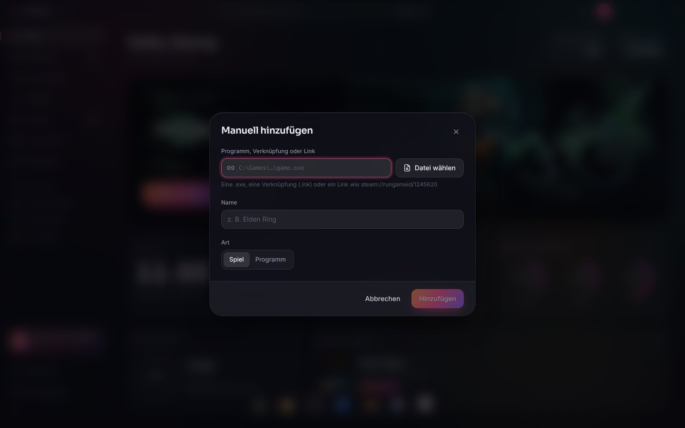

Datei wählen (oder Link eintippen), Name, Art (Spiel oder Programm) – fertig. Danach öffnet sich die Spiel-Seite.

---

## 4. Spiel-Seite

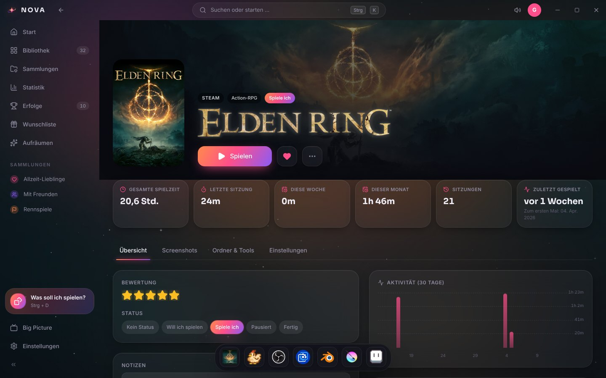

**Oben:** großes Hintergrundbild, Cover, Logo, Quelle und Status. Knopf **Spielen** (läuft es, **Beenden** mit Rückfrage), **Herz** für Favorit, **„…“** für das Rechtsklick-Menü.

**Zahlen:** Gesamte Spielzeit · Letzte Sitzung · Diese Woche · Dieser Monat · Sitzungen · Zuletzt gespielt (und wann zum ersten Mal).

### Reiter „Übersicht“

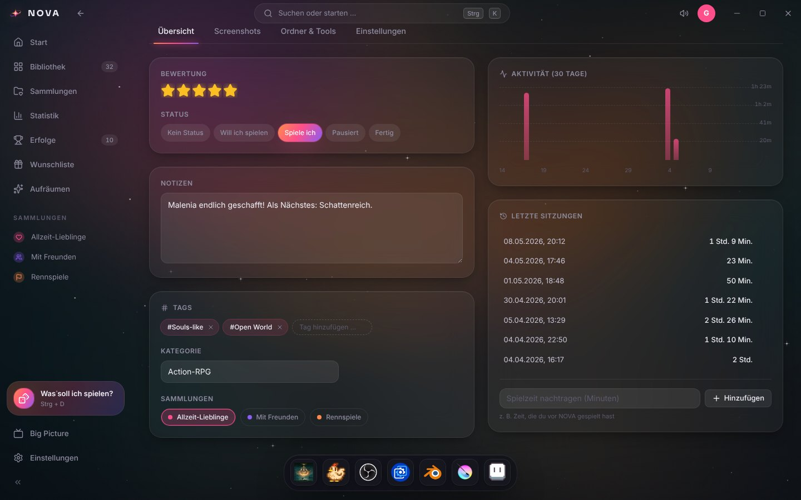

- **Bewertung** – 0 bis 5 Sterne, auch halbe.
- **Status** – Will ich spielen / Spiele ich / Pausiert / Fertig.
- **Notizen** – speichern sich von selbst.
- **Tags** – eigene Stichwörter, z. B. „Koop“ (Enter fügt hinzu).
- **Kategorie** – z. B. „Rennspiel“.
- **Sammlungen** – per Klick an- und abwählen.
- **Aktivität (30 Tage)** – kleines Balkendiagramm.
- **Letzte Sitzungen** – jede einzeln löschbar.
- **Spielzeit nachtragen** – z. B. für Stunden, die du vor NOVA gespielt hast.

### Reiter „Screenshots“

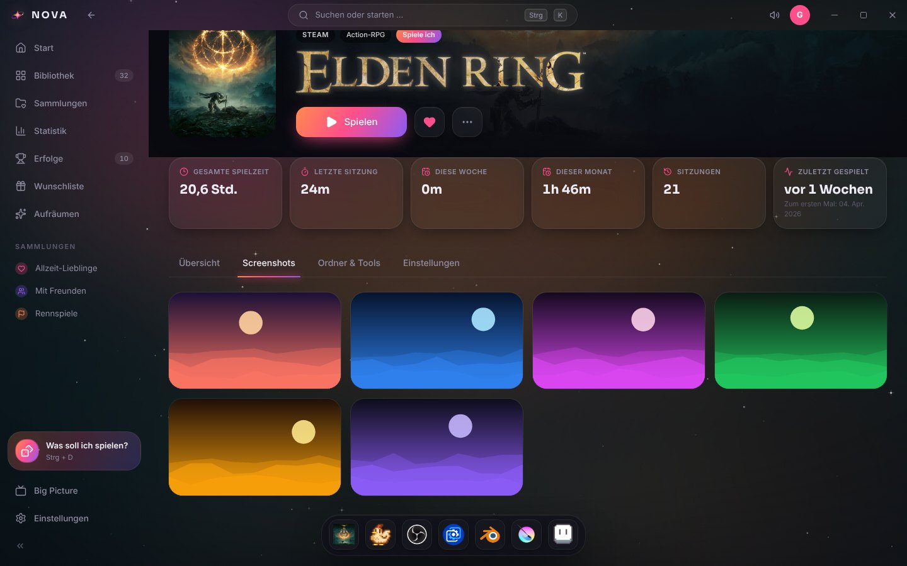

NOVA sucht deine Bildschirmfotos selbst: aus Steam, aus der Xbox Game Bar (`Videos\Captures`), von NVIDIA und aus einem eigenen Ordner. Klick öffnet das Bild groß, mit Pfeiltasten blätterst du, „Im Explorer zeigen“ öffnet den Ordner.

### Reiter „Ordner & Tools“

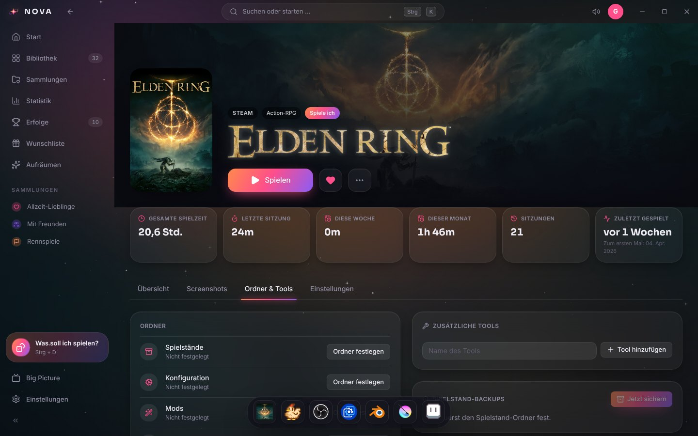

- **Ordner-Verknüpfungen:** Spielstände, Konfiguration, Mods, Screenshots, Installationsordner – jeweils mit einem Klick öffnen.
- **Zusätzliche Tools:** z. B. einen Mod-Manager oder ein Server-Tool zum Spiel eintragen und von hier starten.
- **Spielstand-Backups:** **„Jetzt sichern“** packt deinen Spielstand-Ordner in eine ZIP-Datei. **„Wiederherstellen“** spielt ihn zurück. Vorher sichert NOVA den aktuellen Stand automatisch, damit nichts verloren geht.

### Reiter „Einstellungen“ (für dieses Spiel)

- Name und Art (Spiel oder Programm).
- **Startart:** Programm (`.exe`), Link (`steam://…`) oder Verknüpfung.
- **Startparameter** (z. B. `-windowed -dx11`) und **Arbeitsordner**.
- **„Als Administrator starten“** – nur nötig, wenn ein Spiel es verlangt.
- **Zusätzliche Prozessnamen** – hilft bei Spielen, die über einen eigenen Launcher starten.
- **Bilder:** Cover, Hintergrund, Logo, Icon. „Automatisch laden“, **eigenes Bild** hochladen oder mit SteamGridDB-Schlüssel aus vielen Bildern **auswählen**.

---

## 5. Sammlungen

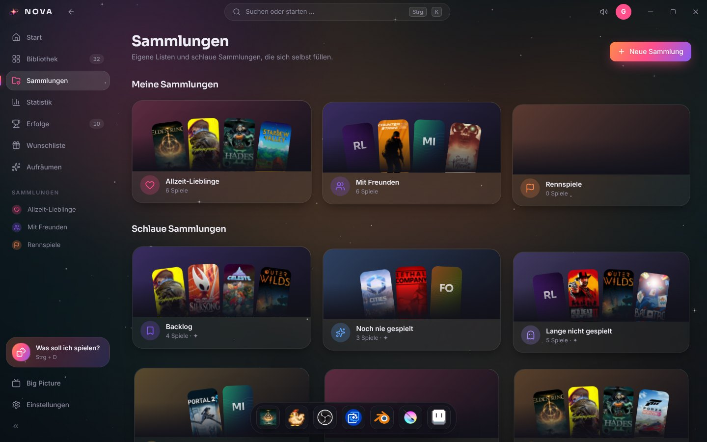

**Eigene Sammlungen:** „Neue Sammlung“ → Name, Symbol, Farbe, Beschreibung. Spiele fügst du per Rechtsklick oder auf der Spiel-Seite hinzu. Ein Spiel kann in mehreren Sammlungen sein. Deine Sammlungen stehen auch links in der Seitenleiste.

**Schlaue Sammlungen (füllen sich von selbst):**
| Name | Was drin ist |
|---|---|
| Backlog | Spiele mit Status „Will ich spielen“ |
| Noch nie gespielt | Spiele ohne gemessene Spielzeit |
| Lange nicht gespielt | Länger als 60 Tage nicht gespielt und nicht fertig |
| Kurz & knackig | Im Schnitt unter 45 Minuten pro Sitzung |
| Dauerbrenner | Mindestens 30 Stunden gespielt |
| Bestbewertet | Ab 4,5 Sternen |
| Durchgespielt | Status „Fertig“ |

---

## 6. Statistik

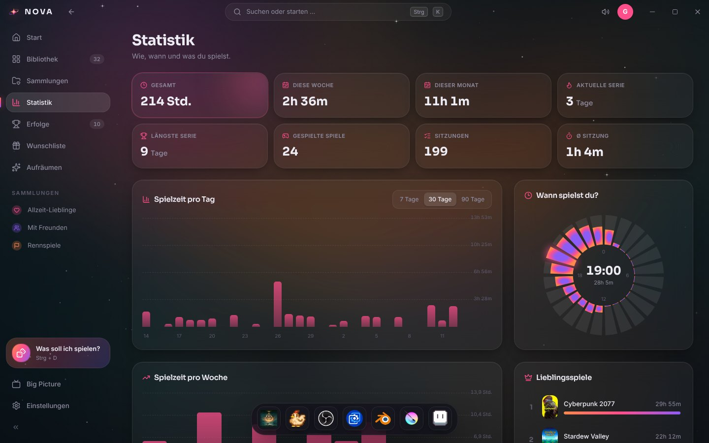

- **Zahlen oben:** Gesamt · Diese Woche · Dieser Monat · Aktuelle Serie (Tage am Stück) · Längste Serie · Gespielte Spiele · Sitzungen · Ø Sitzung.
- **Spielzeit pro Tag** – umschaltbar 7 / 30 / 90 Tage.
- **„Wann spielst du?“** – eine 24-Stunden-Uhr. Deine stärkste Stunde leuchtet.
- **Spielzeit pro Woche** – die letzten 12 Wochen.
- **Lieblingsspiele** – deine Top 8.

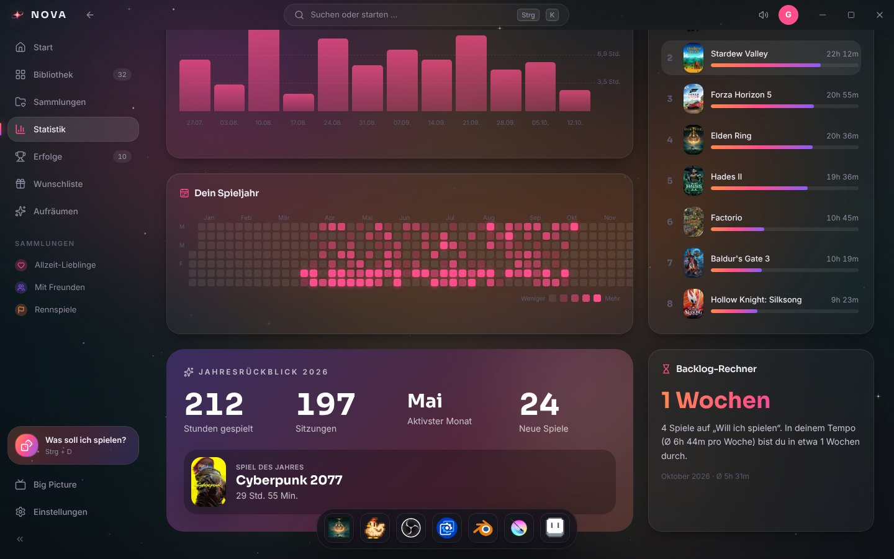

- **„Dein Spieljahr“** – ein Kästchen pro Tag, je dunkler, desto mehr gespielt.
- **Jahresrückblick** – Stunden, Sitzungen, aktivster Monat, neue Spiele und dein **Spiel des Jahres**.
- **Backlog-Rechner** – rechnet aus, wie lange du in deinem Tempo für alle „Will ich spielen“-Spiele brauchst. Zum Beispiel: „In deinem Tempo bist du in etwa 4 Monaten durch“.

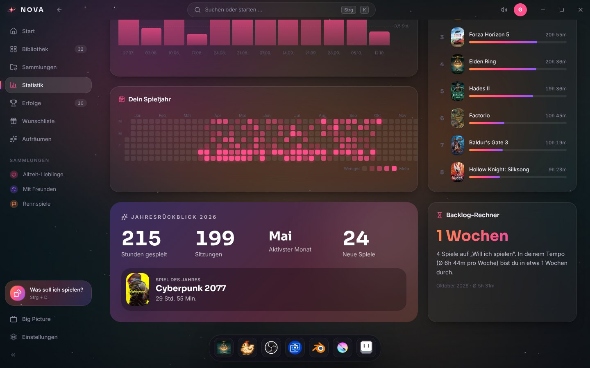

---

## 7. Erfolge

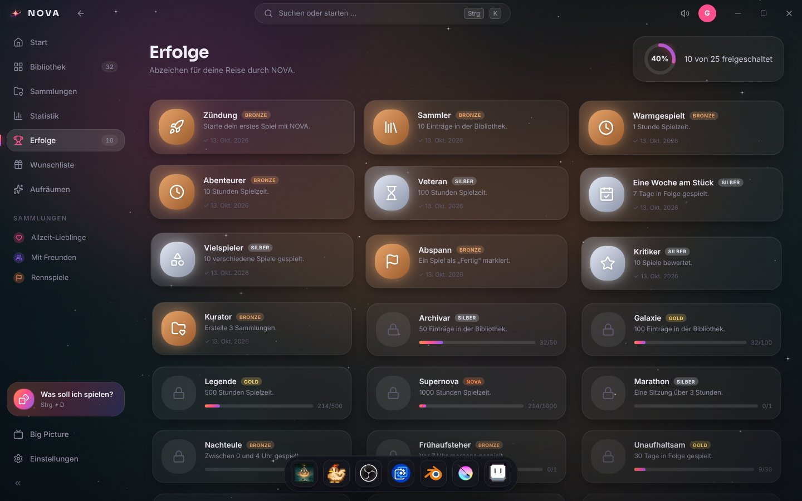

25 Abzeichen in vier Stufen (Bronze, Silber, Gold, Nova). Freigeschaltete stehen oben mit Datum, die anderen zeigen deinen Fortschritt. Beim Freischalten erscheint oben eine Meldung mit Klang und Funken.

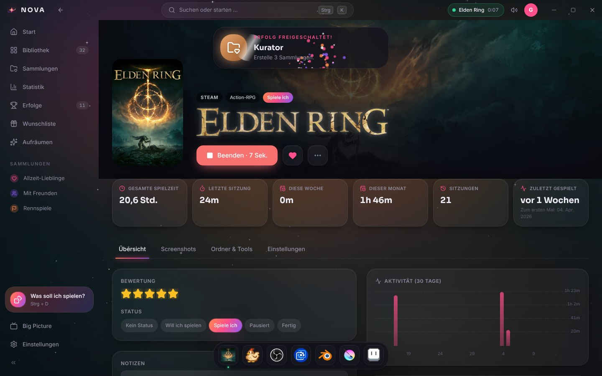

| Erfolg | So bekommst du ihn |
|---|---|
| Zündung | Erstes Spiel gestartet |
| Sammler / Archivar / Galaxie | 10 / 50 / 100 Einträge in der Bibliothek |
| Warmgespielt / Abenteurer / Veteran / Legende / Supernova | 1 / 10 / 100 / 500 / 1000 Stunden Spielzeit |
| Marathon | Eine Sitzung von 3 Stunden |
| Nachteule | Zwischen 0 und 4 Uhr nachts gespielt |
| Frühaufsteher | Zwischen 4 und 7 Uhr morgens gespielt |
| Eine Woche am Stück / Unaufhaltsam | 7 / 30 Tage hintereinander gespielt |
| Vielspieler | 10 verschiedene Spiele gespielt |
| Abspann / Komplettist | 1 / 10 Spiele auf „Fertig“ |
| Kritiker | 10 Spiele bewertet |
| Kurator | 3 eigene Sammlungen angelegt |
| Glücksspieler | 5-mal gewürfelt |
| Wunschdenker | 5 Wünsche auf der Wunschliste |
| Sofa-Modus | Big Picture geöffnet |
| Tastatur-Held | Befehlspalette 10-mal benutzt |
| Auf Nummer sicher | Einen Spielstand gesichert |
| Fotograf | Screenshots eines Spiels angesehen |

---

## 8. Wunschliste

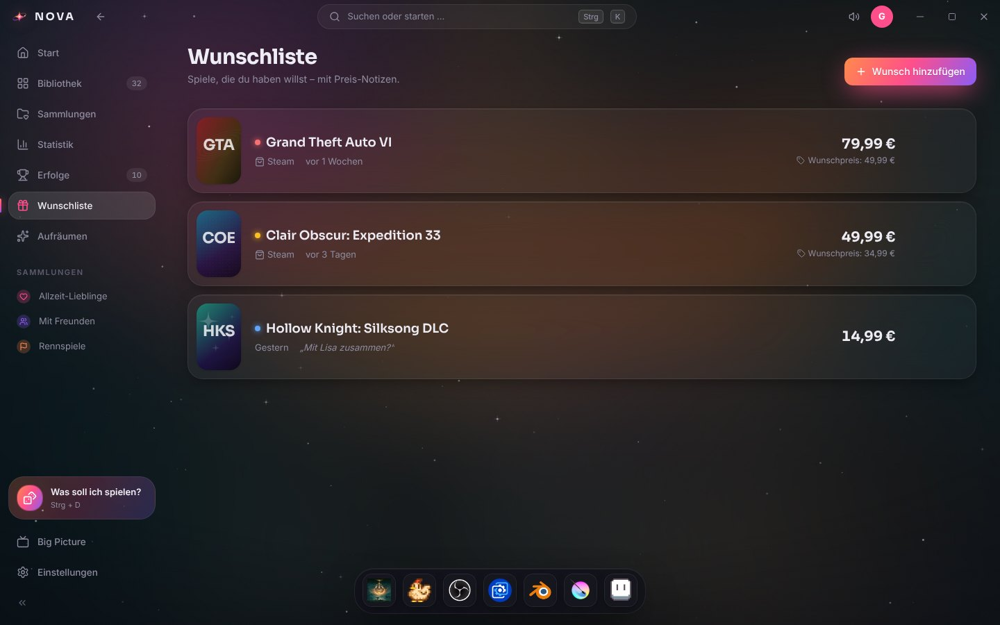

**„Wunsch hinzufügen“:** Spiel, aktueller Preis, Wunschpreis, Shop, Link, Priorität (hoch/mittel/niedrig), Notiz.
Die Liste ist nach Priorität sortiert (Punkt rot, gelb oder blau). Ist der Preis bei oder unter deinem Wunschpreis, wird er **grün**. Beim Überfahren: Link öffnen, bearbeiten, löschen.
Die Preise trägst du selbst ein – NOVA fragt keine Shops ab.

---

## 9. Aufräumen

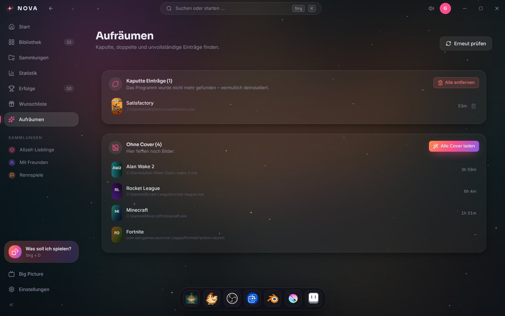

- **Kaputte Einträge** – das Programm gibt es nicht mehr (z. B. deinstalliert). Einzeln oder alle entfernen.
- **Mögliche Doppelte** – gleiche Steam-ID, gleiche `.exe` oder gleicher Name. Klick auf **„Behalten“** beim richtigen Eintrag führt die Gruppe zusammen: **Spielzeit, Sammlungen, Tags, Notizen und Bewertung der anderen werden übernommen**, dann verschwinden die Doppelten.
- **Ohne Cover** – Spiele ohne Bild. „Alle Cover laden“ holt sie in einem Rutsch.
- Ist alles in Ordnung: „Alles sauber!“.

---

## 10. Einstellungen

Links eine Abschnittsliste, die beim Scrollen mitläuft. Jedes Profil hat eigene Einstellungen.

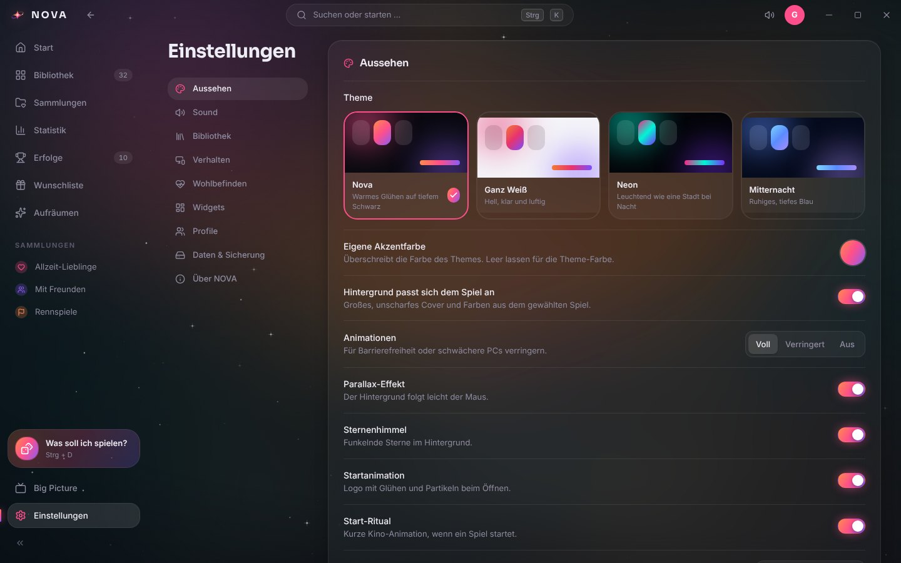

**Aussehen**
- **Theme:** Nova, Ganz Weiß, Neon, Mitternacht (siehe Abschnitt 18). Der Wechsel breitet sich als Lichtkreis von deinem Klick aus.
- **Eigene Akzentfarbe** – jede Farbe, die du willst.
- **Hintergrund passt sich dem Spiel an** – an/aus.
- **Animationen:** Voll / Verringert / Aus. Hat Windows „Animationen reduzieren“ an, nimmt NOVA automatisch „Verringert“.
- **Parallax-Effekt**, **Sternenhimmel**, **Startanimation**, **Start-Ritual** – einzeln abschaltbar.
- **Sprache:** Deutsch oder Englisch.

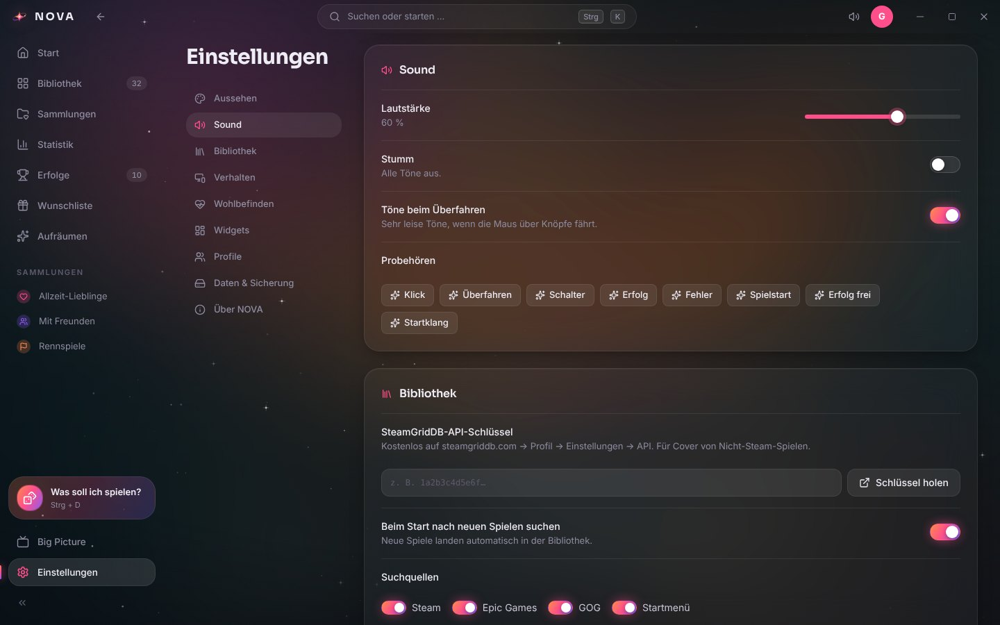

**Sound**
- **Lautstärke**, **Stumm**, **Töne beim Überfahren**.
- **Probehören** – alle Klänge einzeln anhören. Die Töne erzeugt NOVA selbst (Glas- und Glockenklänge), es gibt keine Sounddateien.

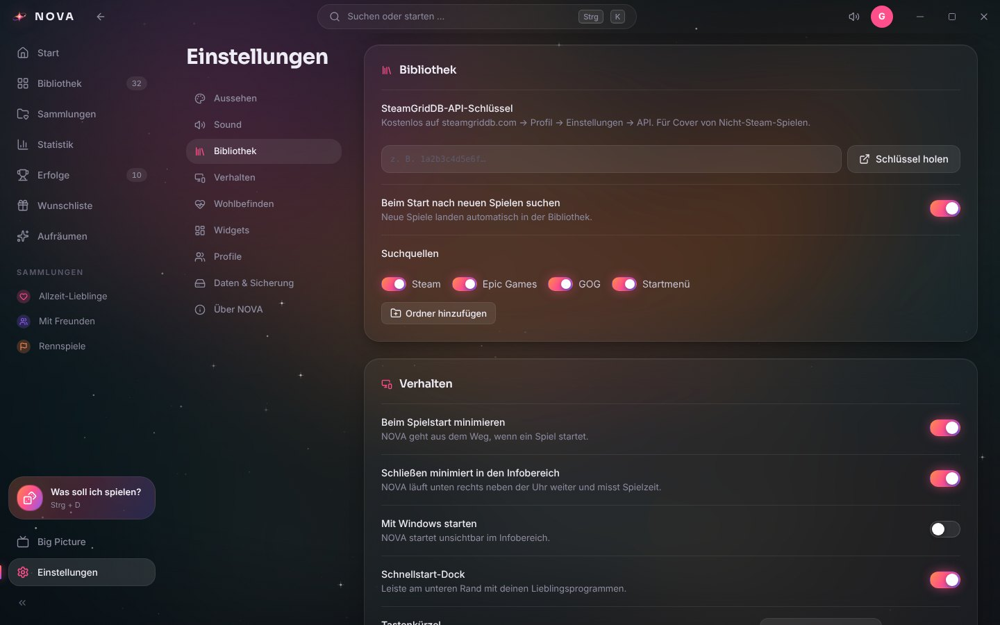

**Bibliothek**
- **SteamGridDB-Schlüssel** – kostenlos und freiwillig. Nur nötig für Spiele, die es bei Steam nicht gibt, oder wenn du aus vielen Bildern auswählen willst. Der Knopf „Schlüssel holen“ öffnet die Seite.
- **Beim Start nach neuen Spielen suchen**.
- **Suchquellen** – Steam, Epic, GOG, Startmenü und eigene Ordner.

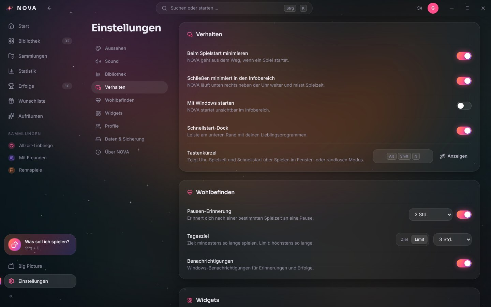

**Verhalten**
- **Beim Spielstart minimieren**.
- **Schließen minimiert in den Infobereich** – NOVA bleibt unsichtbar aktiv und misst weiter.
- **Mit Windows starten** – NOVA startet leise im Infobereich.
- **Schnellstart-Dock** – an/aus.
- **Tastenkürzel fürs Mini-Overlay** – Knopf anklicken, neue Kombination drücken. „Anzeigen“ testet es.

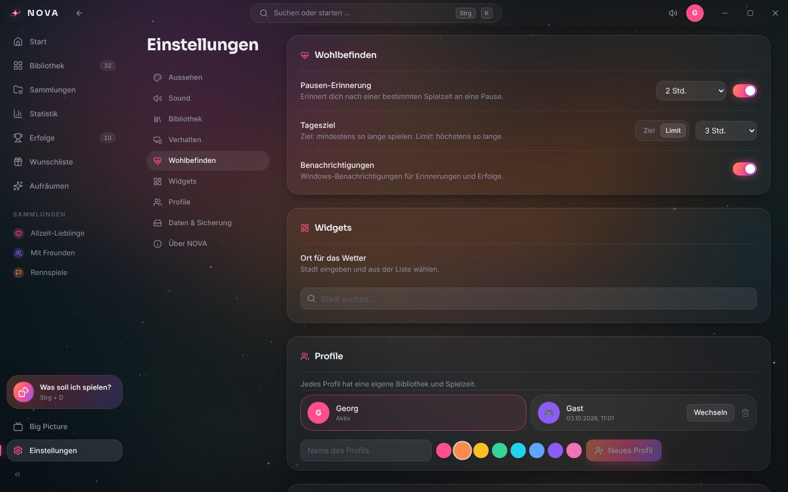

**Wohlbefinden**
- **Pausen-Erinnerung** – nach 30 Min. bis 4 Std. am Stück erinnert NOVA dich an eine Pause (und dann immer wieder im gleichen Abstand).
- **Tagesziel** – als Ziel oder Limit, 30 Min. bis 6 Std. (für das Widget auf der Startseite).
- **Benachrichtigungen** – Windows-Meldungen für Pausen und Erfolge.

**Widgets** – Ort für das Wetter suchen und auswählen.

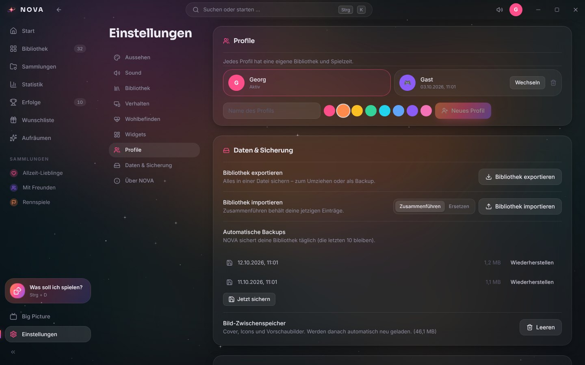

**Profile** – z. B. für Geschwister am selben PC. Jedes Profil hat eine eigene Bibliothek, eigene Spielzeit, eigene Erfolge und eigene Einstellungen. Neues Profil: Name und Farbe wählen. Wechseln oder löschen per Knopf.

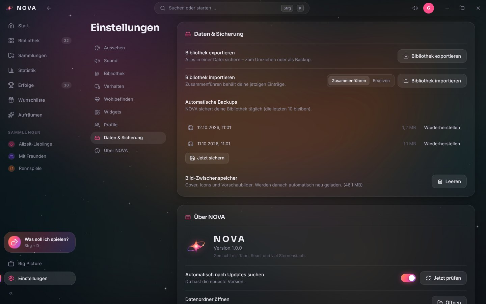

**Daten & Sicherung**
- **Bibliothek exportieren** – alles in eine Datei (z. B. zum Umziehen auf einen neuen PC).
- **Bibliothek importieren** – „Zusammenführen“ (zur bestehenden dazu) oder „Ersetzen“. Vorher macht NOVA automatisch eine Sicherung.
- **Automatische Backups** – Liste der letzten Sicherungen, „Wiederherstellen“ oder „Jetzt sichern“.
- **Bild-Zwischenspeicher** – zeigt, wie viel Platz die Bilder belegen. „Leeren“ gibt ihn frei, danach lädt NOVA alle Bilder automatisch neu.

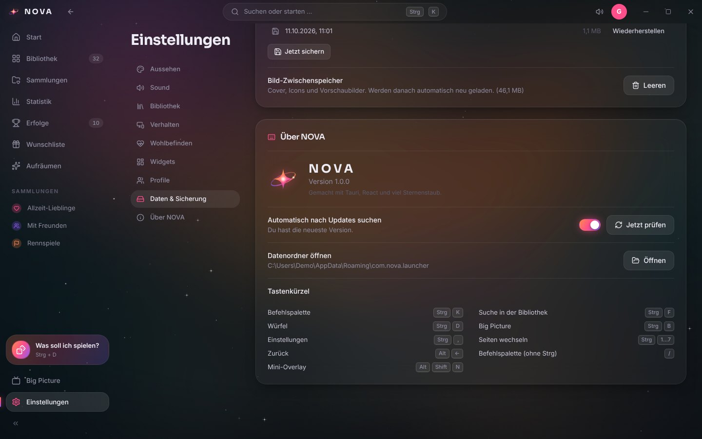

**Über NOVA** – Version, **automatische Update-Prüfung** („Jetzt prüfen“, „Jetzt aktualisieren“), Datenordner öffnen und die Liste der Tastenkürzel.
Updates: NOVA lädt das neue Setup, prüft den Fingerabdruck (SHA-256), installiert und startet sich neu.

---

## 11. Befehlspalette (Strg+K)

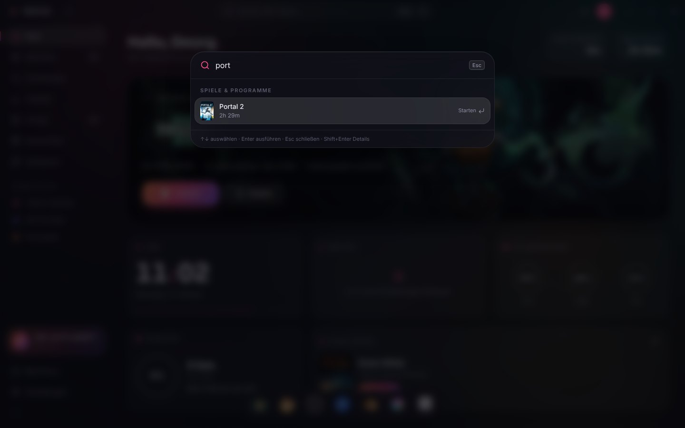

Öffnen mit **Strg+K**, mit **/** oder per Klick auf das Suchfeld oben. Dann einfach tippen:
- **Spiele & Programme** – Enter startet, Shift+Enter öffnet die Spiel-Seite.
- **Aktionen** – Würfeln, Bibliothek scannen, Eintrag hinzufügen, Big Picture, Overlay an/aus, Sound an/aus, Animationen an/aus, nach Updates suchen, Theme wechseln.
- **Seiten** – direkt zu jeder Seite springen.

Pfeiltasten wählen aus, Enter führt aus, Esc schließt.

---

## 12. Würfel „Was soll ich spielen?“

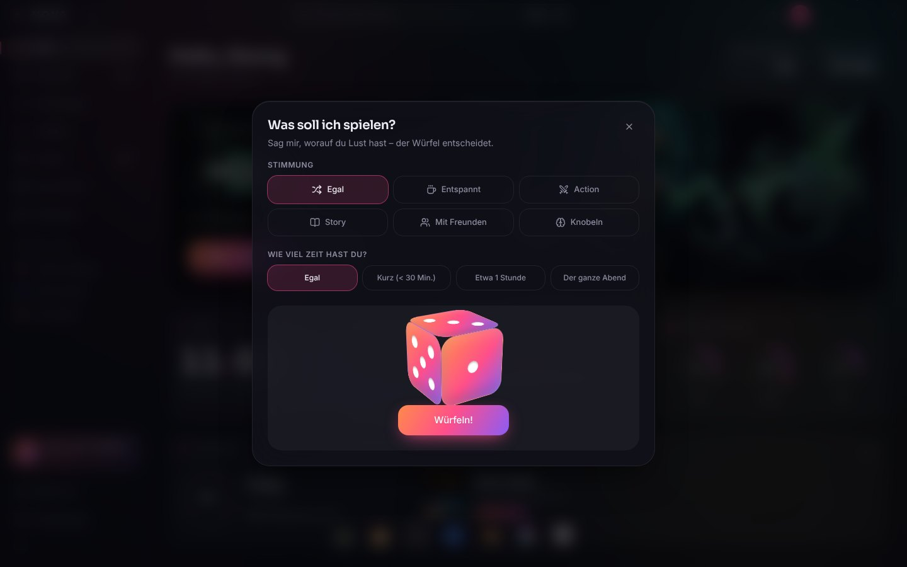
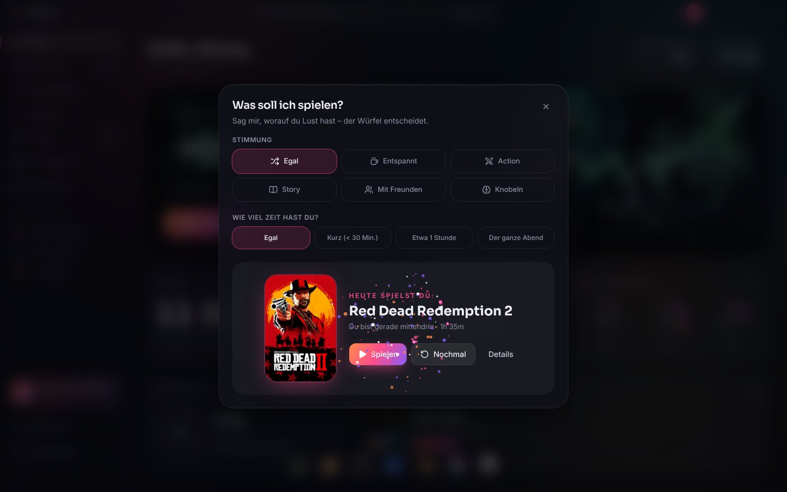

Öffnen mit **Strg+D** oder dem Knopf links unten.
1. **Stimmung** wählen: Egal, Entspannt, Action, Story, Mit Freunden, Knobeln.
2. **Zeit** wählen: Egal, Kurz (unter 30 Min.), Etwa 1 Stunde, Der ganze Abend.
3. **„Würfeln!“** – ein 3D-Würfel rollt, dann: „Heute spielst du: …“ mit Grund (z. B. „Liegt auf deinem Backlog“ oder „Lange nicht gespielt“).
4. **Spielen**, **Nochmal** oder **Details**.

So entscheidet der Würfel: Stimmung und Zeit erkennt NOVA an den Kategorien und Tags deiner Spiele (z. B. „Koop“, „RPG“, „Puzzle“). Fertige Spiele lässt er weg. Spiele auf „Will ich spielen“ und lange nicht gespielte kommen öfter dran, heute schon gespielte seltener.

---

## 13. Big Picture (fürs Sofa)

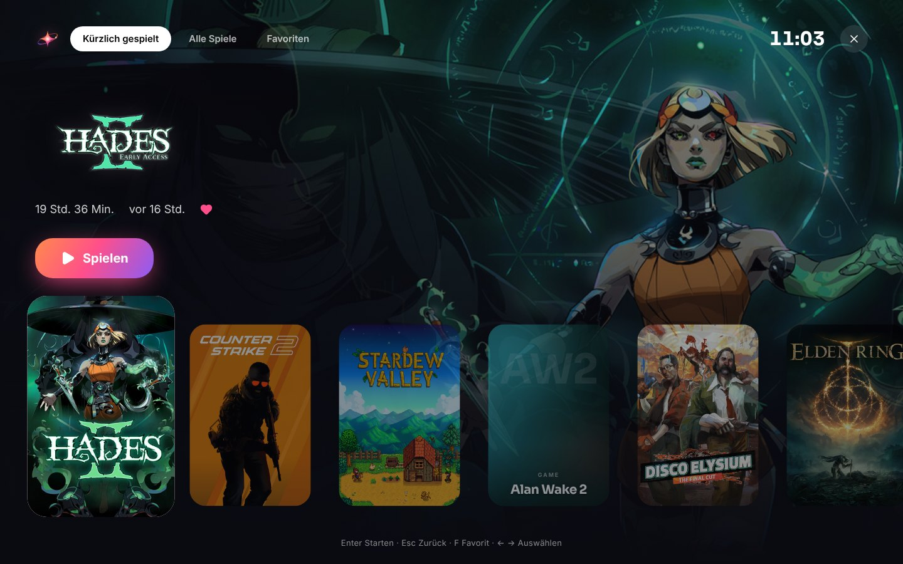

Öffnen mit **Strg+B**, über die Seitenleiste oder das Symbol neben der Uhr. Vollbild mit großen Covern, gemacht für Fernseher und Controller.
- Reihen: Kürzlich gespielt, Alle Spiele, Favoriten. Große Uhr oben rechts.
- **Controller:** A starten, B zurück, Y Favorit, LB/RB Reihe wechseln, Steuerkreuz oder linker Stick zum Auswählen.
- **Tastatur:** Pfeiltasten, Enter starten, Esc verlassen, F Favorit.
- Unten steht immer, welche Taste was macht.

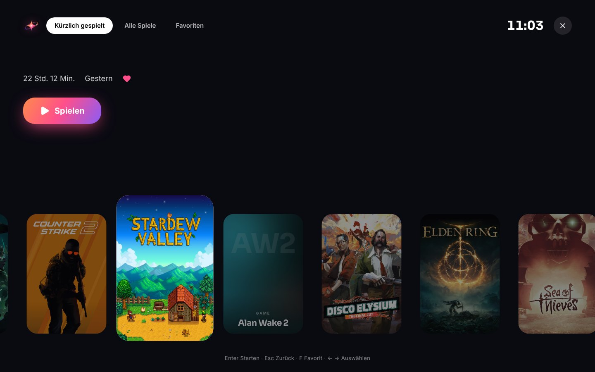

---

## 14. Mini-Overlay (über dem Spiel)

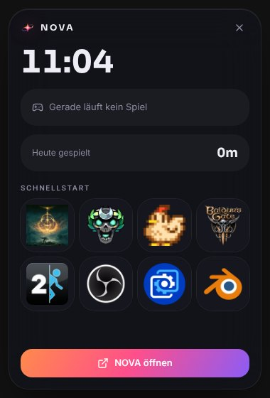

Ein kleines Fenster, das über allem liegt. Öffnen und Schließen mit **Alt+Shift+N** (änderbar) – auch mitten im Spiel.
Es zeigt: Uhrzeit · laufendes Spiel mit Sitzungsdauer · heute gespielt · **Schnellstart** deiner Favoriten · Knopf „NOVA öffnen“.
Funktioniert bei Spielen im **Fenster- oder randlosen Vollbild**. Über „exklusivem Vollbild“ kann Windows kein fremdes Fenster zeigen.

---

## 15. Schnellstart-Dock

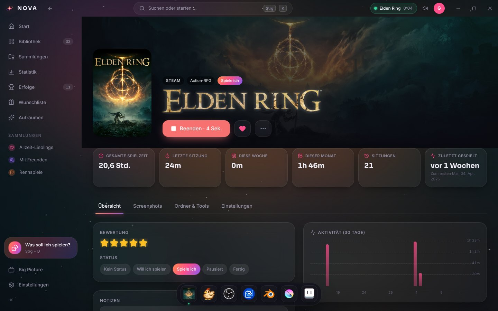

Die Leiste unten mit Lupen-Effekt (wie beim Mac). Klick startet, ein grüner Punkt zeigt „läuft“.
**So kommt ein Spiel ins Dock:** Rechtsklick auf das Spiel → **„Im Dock“**. Bis zu 14 Einträge. Solange nichts markiert ist, bleibt das Dock unsichtbar.

---

## 16. Symbol neben der Uhr (Tray)

Rechtsklick auf das NOVA-Symbol unten rechts neben der Uhr:
**Nova öffnen · Zuletzt gespielt** (bis zu 6 Spiele, direkt starten) **· Big Picture · Zufallsspiel · Overlay · Beenden**.
Linksklick öffnet NOVA.

---

## 17. Alle Tastenkürzel

| Taste | Was passiert |
|---|---|
| Strg+K oder / | Befehlspalette |
| Strg+F | Bibliothek durchsuchen |
| Strg+D | Würfel |
| Strg+B | Big Picture |
| Strg+, | Einstellungen |
| Strg+1 … Strg+7 | Start, Bibliothek, Sammlungen, Statistik, Erfolge, Wunschliste, Aufräumen |
| Alt+← | Zurück |
| Alt+Shift+N | Mini-Overlay ein/aus (funktioniert überall, auch im Spiel) |
| Doppelklick auf Spiel | Starten |
| Esc | Fenster/Menü schließen |

---

## 18. Themes

| Nova (Standard) | Ganz Weiß |
|---|---|
|  | 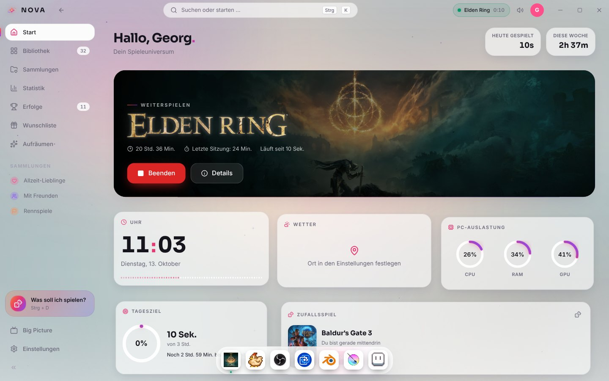 |
| **Neon** | **Mitternacht** |
| 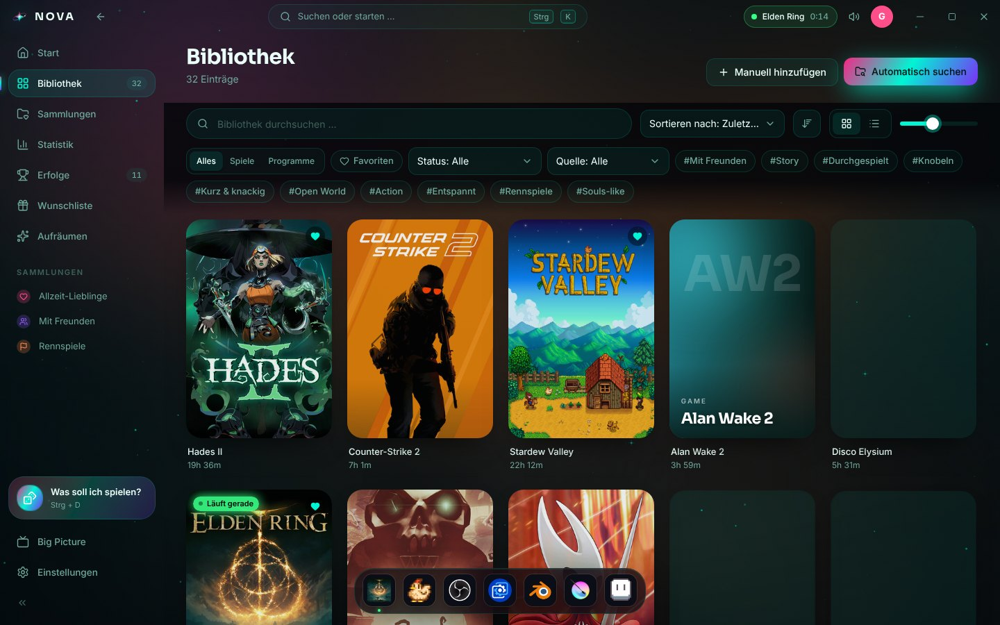 | 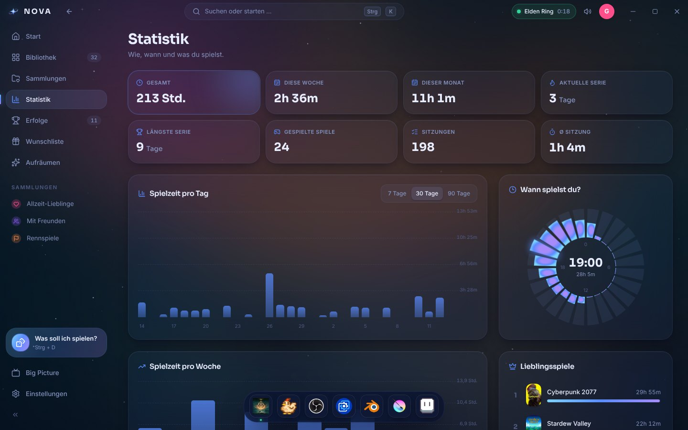 |

Dazu jede **eigene Akzentfarbe**, hier Grün:

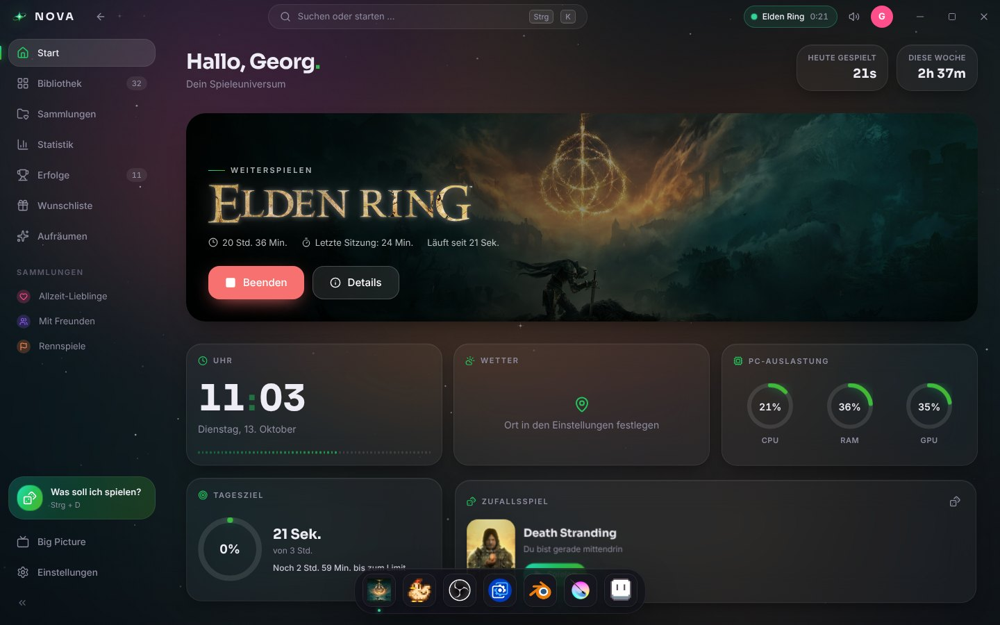

---

## 19. Der Installer

`NovaLauncher-Setup.exe` – eigenes, animiertes Fenster mit Klängen (Ton-Knopf oben rechts) und Sprachwahl DE/EN.

1. **Willkommen** – kurze Vorstellung, Version und Download-Größe.
2. **Speicherort** – Vorschlag ohne Adminrechte. Zeigt freien Platz. Nur wenn du einen geschützten Ordner wählst (z. B. `C:\Programme`), fragt Windows nach Adminrechten.

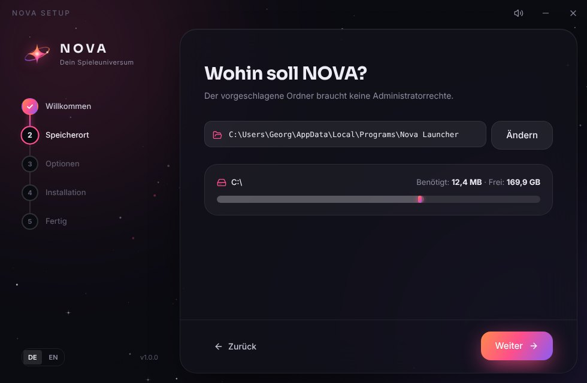

3. **Optionen** – Desktop-Verknüpfung, Startmenü, Mit Windows starten, NOVA danach starten.

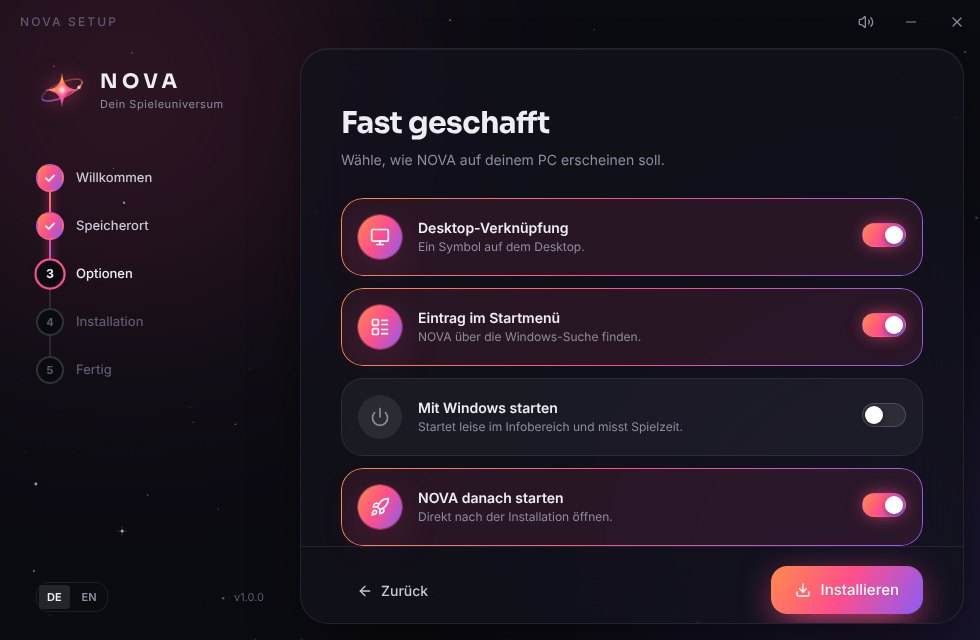

4. **Installation** – lädt die App aus dem Internet: Prozent, MB/s, Restzeit. Prüft den Fingerabdruck (SHA-256). Bricht das Internet ab, macht der Download später **an derselben Stelle weiter**. Bei Fehlern gibt es eine klare Meldung und „Erneut versuchen“.
5. **Fertig** – „NOVA ist bereit!“. War „NOVA danach starten“ an, startet NOVA nach 5 Sekunden von selbst (mit „Nicht starten“ abbrechbar).

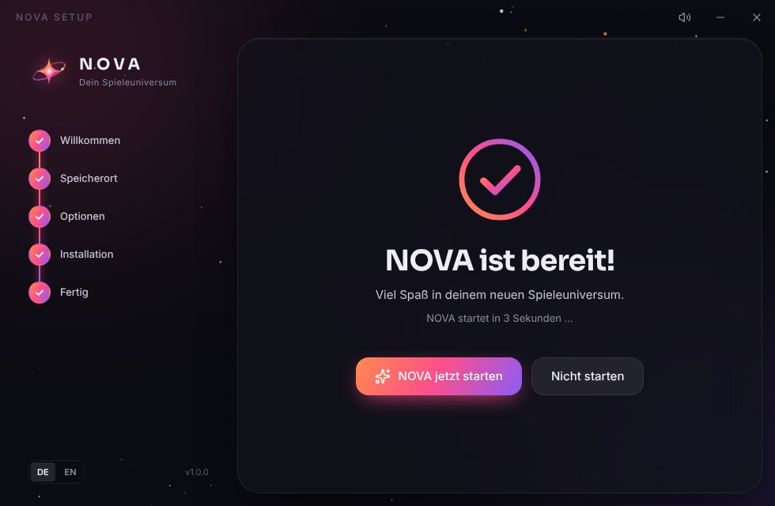

**Setup ein zweites Mal starten** (NOVA ist schon da): **Aktualisieren oder reparieren** – deine Bibliothek bleibt – oder **Deinstallieren**.

**Deinstallieren** geht auch über Windows → „Apps & Features“. Häkchen **„Meine Daten behalten“**: dann bleiben Bibliothek und Spielzeit für später erhalten. Fremde Dateien im Ordner fasst der Deinstaller nie an.

---

## 20. Was noch nicht drin ist

Ehrlich aufgelistet – das sind kleine Lücken, nichts davon stört die Hauptfunktionen:
- **Wunschliste:** kein Knopf „Gekauft“ und keine automatische Preisabfrage – Preise sind Notizen.
- **Profile** lassen sich nicht umbenennen oder umfärben (nur neu anlegen).
- Die **Reihenfolge der Sammlungen** lässt sich nicht ändern.
- Beim **App-Update** gibt es nur einen Ladekreis, keinen Fortschrittsbalken (der Installer selbst hat einen).
- Beim Würfel filtert **„Etwa 1 Stunde“** nichts heraus – es wirkt wie „Egal“.
