# PULSAR – Alle Funktionen mit Bildern

Die Bilder stammen aus der Oberfläche im Browser mit Demo-Daten (`node scripts/feature-shots.mjs`).
In der echten App sehen die Seiten genauso aus – nur mit deinen Werten statt der Demo-Zahlen.

> Ehrlich vorweg: Pulsar hat **kein eigenes Servernetz**. Es misst, erklärt und optimiert, was sich auf deinem PC
> optimieren lässt. Einen Ping „umleiten“ kann es nicht – das kann kein Programm ohne eigene Server.

---

## Start

### Startanimation

Der Pulsar baut sich auf: Kern, Strahlen, Ring, Druckwellen im Takt, Sternenstaub. Danach gleitet das Logo in die
Titelleiste. Abschaltbar unter **Einstellungen → Aussehen → Startanimation**.

---

## Cockpit

### Übersicht

- **„Weiterspielen“-Banner** (oben, wie bei NOVA): Hintergrundbild und Logo deines zuletzt gespielten Spiels, Spielzeit, wann zuletzt gespielt, Note der letzten Runde mit Ø-Ping und Spitzen. Knöpfe: **Boost & Spielen**, **Spielen**, **Details**. Oben rechts steht, wohin Pulsar während des Spiels misst. Läuft ein Spiel, zeigt das Banner die laufende Zeit und **Beenden**. Spiele ohne breites Bild bekommen ein schwebendes Cover.
- Das Spielbild färbt den Hintergrund der App leicht ein.
- **Verbindungsnote** (links): A+ bis F aus Ping, Schwankung (Jitter) und Paketverlust. Mit einem Satz, was sie bedeutet.
- **Live-Ping** (Mitte): Messung jede Sekunde zum eingestellten Messziel (Rechenzentrum oder echter Spielserver). Kurve für 60 s, 5 min oder 15 min; Ø, Min, Max, Schwankung, Verlust. Die rote gestrichelte Linie ist deine Warnschwelle.
- **BOOST** (rechts): der große Knopf.
- Oben rechts: Kabel oder WLAN und die Verbindungsgeschwindigkeit.
- In der Seitenleiste: **Zuletzt gespielt** mit Spiel-Icons – Klick öffnet das Spiel, der Play-Knopf startet es mit Boost.

### Kürzlich gespielt, PC-Auslastung, letzte Runde, Favoriten

- **Kürzlich gespielt**: Cover-Reihe mit Pfeilen zum Blättern (Überfahren: 3D-Neigung, Lichtreflex, Play-Knopf).
- **PC-Auslastung** (CPU, RAM, GPU) und **Schnellzugriff** auf Regionen, Route, DNS, Speedtest.
- **Letzte Runde**: Bericht mit Ping-Verlauf und Note.
- **Favoriten**: zweite Cover-Reihe mit deinen Lieblingsspielen.
- **Schnellzugriff „Warum laggt es?“** öffnet die geführte Prüfung (siehe Netzwerk).

### Lag-Detektiv und „Hör dein Netz“ in der Live-Ping-Karte
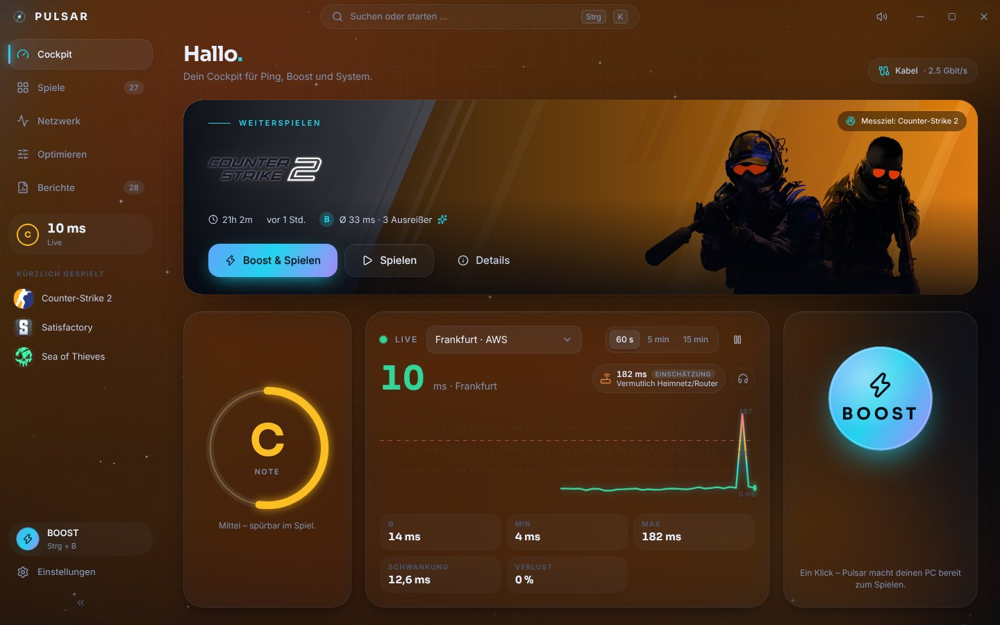
- **Lag-Detektiv:** Springt der Ping plötzlich hoch (ein **Ausreißer**), macht Pulsar sofort eine **Momentaufnahme**
  von etwa einer Sekunde: das Messziel noch einmal, die ersten drei Stationen der Route, dein Router, das WLAN-Signal,
  der Datenverkehr auf diesem PC und die CPU-Last. Daraus schätzt Pulsar die Ursache. Im Cockpit steht dann eine
  Minute lang z. B. „182 ms · Vermutlich Heimnetz/Router“ mit dem Zusatz **Einschätzung**. Klick darauf öffnet die
  Einzelheiten unter **Netzwerk → Verbindung**. Ist der PC stark ausgelastet, steht dort zusätzlich „PC ausgelastet“.
- **Hör dein Netz** (Kopfhörer-Knopf neben dem Ausreißer): macht den Live-Ping hörbar – ein leiser Pulsar-Puls je
  Messung. Gleichmäßig = stabil, stolpernd = Schwankung, Lücken = Verlust, ein betonter Puls = Ausreißer. Die Tonhöhe
  folgt auf Wunsch dem Ping (hell = niedrig, dunkel = hoch – keine Melodie). Startet nur per Klick, stoppt, wenn du
  Pulsar in den Infobereich schickst oder der Monitor pausiert. Die vier Balken im Knopf zeigen den letzten Puls.

Ehrlich dazu: Die Ursache ist eine **Einschätzung** aus einer Momentaufnahme, keine Gewissheit – war der Ausreißer
schon vorbei, heißt sie „unklar“. Pulsar sieht andere Geräte im Haushalt nicht; lädt dort jemand, sieht das aus wie
„Anschluss/Anbieter“. Mit VPN bleibt die Ursache „unklar“. Für die Momentaufnahme sendet Pulsar ein paar kleine
Pakete (abschaltbar unter **Einstellungen → Messung**). Der Ton übersetzt nur die Messung in Klang – er verbessert
nichts, und das Stolpern ist nicht das echte Timing einzelner Pakete.

### BOOST

Ein Klick (oder `Strg + B`):
1. **Energieplan auf Höchstleistung** – die CPU darf immer mit vollem Takt laufen.
2. **Spiel bevorzugen** – Windows gibt dem Spielprozess mehr CPU-Zeit (Priorität „Hoch“).
3. **DNS-Zwischenspeicher leeren** – frische Serveradressen.

Jede Aktion wird einzeln gemeldet (grün = erledigt, gelb = nicht möglich, z. B. bei Anti-Cheat-geschützten Spielen).
**Beenden** stellt alles wieder her: den alten Energieplan und die alte Priorität. Auch beim Schließen von Pulsar.
Das Boost-Profil (was genau passiert) stellst du unter **Optimieren** ein.

---

## Spiele

### Übersicht, Hover, Favoriten, Suche

- Steam-, Epic- und GOG-Spiele werden automatisch gefunden (**Automatisch suchen**), alles andere per **Manuell hinzufügen** oder indem du eine `.exe` ins Fenster ziehst.
- Cover, Hintergrundbilder, Logos und Icons kommen von Steam bzw. aus der Programmdatei – ohne Anmeldung.
- Beim Überfahren: **Boost & Spielen** (startet Boost + Spiel) oder nur **Spielen**.
- Filter: Spiele/Programme, Favoriten, Quelle; Sortierung; Kachelgröße; Liste oder Raster. Suche findet auch Abkürzungen („cs2“).

### Spiel-Seite

- Kopf: Cover, Logo, Quelle, Verbindungsnote der letzten Runde, **Boost & Spielen**, Favorit, Menü.
- Kennzahlen: Spielzeit gesamt, letzte Sitzung, Sitzungen, zuletzt gespielt, Ø Ping.
- **Übersicht:** Spielzeit der letzten 30 Tage, letzte Runde, **Messziel für dieses Spiel** (Region) und **echte Spielserver** für Counter-Strike 2, Dota 2, Deadlock und League of Legends – Pulsar misst dann die Server des Spiels.
- **Berichte:** alle Runden dieses Spiels.
- **Einstellungen:** Auto-Boost nur für dieses Spiel, eigenes Boost-Profil, Startart (.exe, Link, Verknüpfung), Startparameter, Arbeitsordner, zusätzliche Prozessnamen (für Launcher-Spiele), Name, Art, Bilder (automatisch oder eigene).

---

## Netzwerk

### Regionen

Ping zu rund 25 Rechenzentren weltweit (AWS), nach Erdteil sortiert, mit Note, Schwankung und Verlust.
**Favoriten messen** oder **Alle messen**; die beste Region wird hervorgehoben. **Als Messziel** macht sie zum Ziel des Live-Pings im Cockpit.
Rechts: **Echte Spielserver** – Valve (CS2, Dota 2, Deadlock) und Riot (LoL) veröffentlichen die Adressen ihrer Server; Pulsar misst sie direkt. Die Auswahl zeigt das Icon des Spiels, wenn es in deiner Liste ist.

### Route

Station für Station zum Ziel. Jede Station ist eingeordnet: **Dein Netz** (Router/WLAN), **Dein Anbieter**, **Internet**, **Ziel** – vor der ersten Analyse erklärt eine kleine Grafik die vier Zonen. Schnellziele: aktuelles Messziel, Cloudflare, Google, Steam.
Das Fazit sagt dir in einem Satz, wo der größte Sprung passiert – und was du daran ändern kannst.

### DNS

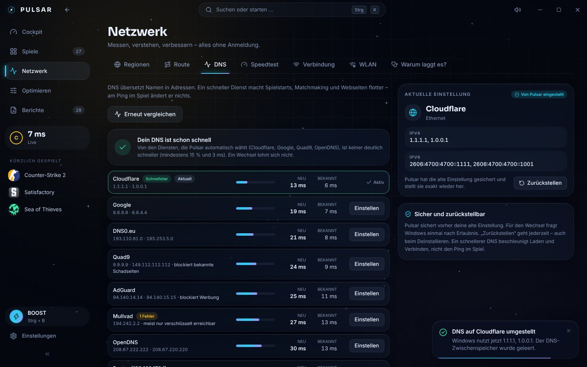
Vergleicht Cloudflare, Google, Quad9, OpenDNS, AdGuard, DNS0.eu, Mullvad und deinen aktuellen DNS – jeweils für neue und bekannte Adressen. Vor dem ersten Vergleich zeigt die Seite, welche Dienste geprüft werden. Sie zeigt auch, was gerade eingestellt ist (z. B. „automatisch vom Router“).
- **Empfehlung:** Ist einer der Dienste, die Pulsar auch automatisch wählt (Cloudflare, Google, Quad9, OpenDNS), deutlich schneller als deiner (mindestens 15 % und 3 ms), schlägt Pulsar ihn vor – der Knopf mit seinem Namen (z. B. **Cloudflare einstellen**) stellt ihn für deine Hauptverbindung ein. Sonst steht dort „Dein DNS ist schon schnell“. War ein anderer Dienst (AdGuard, DNS0.eu, Mullvad) noch schneller, steht dort ein Hinweis – den kannst du, wie jeden anderen Dienst, mit **Einstellen** in seiner Zeile wählen. Nach einer Änderung heißt es „Dein jetziger DNS wurde noch nicht gemessen“ – vergleiche dann erneut.
- **Sicher:** Pulsar prüft vorher, ob der Dienst gerade antwortet, und sichert deine alte Einstellung. Für den Wechsel fragt Windows einmal nach (Adminrechte); sagst du **Nein**, ändert sich nichts. Danach steht beim Dienst „Von Pulsar eingestellt“.
- Sind bei der Verbindung mehr als 3 DNS-Server fest eingetragen (je IPv4 bzw. IPv6), ändert Pulsar den DNS dort nicht und sagt das – mehr ließe sich nicht sicher zurückstellen.
- **Zurückstellen** holt die alte Einstellung jederzeit exakt zurück – beim Deinstallieren automatisch. Hat Pulsar den DNS an einer anderen Verbindung geändert (z. B. am Kabel, jetzt bist du im WLAN), steht das hier ebenfalls, und **Zurückstellen** stellt auch diese zurück.
- Klappt ein Wechsel nur teilweise oder antwortet Windows zu spät, sagt Pulsar „Nicht bestätigt“ statt „Nicht geändert“ – dann bitte prüfen oder zurückstellen.
- Kann Pulsar den DNS auf einem PC nicht selbst einstellen (dafür braucht es Windows 10 Version 2004 oder neuer), zeigt die Seite die **Schritt-für-Schritt-Anleitung** fürs Eintragen von Hand mit Knopf, der die Netzwerkeinstellungen öffnet.

Ehrlich dazu: Ein schnellerer DNS beschleunigt nur das Nachschlagen von Adressen – Spielstarts, Shop und Matchmaking werden etwas flotter. Am Ping im Spiel ändert er nichts.

### Speedtest mit Bufferbloat-Note

Download und Upload (über Cloudflare) – und das Wichtigste fürs Spielen: **Wie stark steigt dein Ping, wenn die Leitung ausgelastet ist?**
Das ist Bufferbloat, der häufigste Grund für Lags, „obwohl das Internet schnell ist“. Note A+ bis F mit Erklärung; vor dem ersten Test zeigt die Seite die Notenskala (A+ unter 5 ms Anstieg … F ab 400 ms).

### Verbindung

Alle Netzwerkadapter mit Geschwindigkeit, IP, Router und DNS; die Hauptverbindung ist markiert.
Bei WLAN: Signalstärke als Ring, Band (2,4/5/6 GHz), Kanal, Standard, Datenrate – plus Tipps (z. B. „Für Online-Spiele ist ein Kabel die beste Wahl“).

### Lag-Detektiv (Karte unter Verbindung)
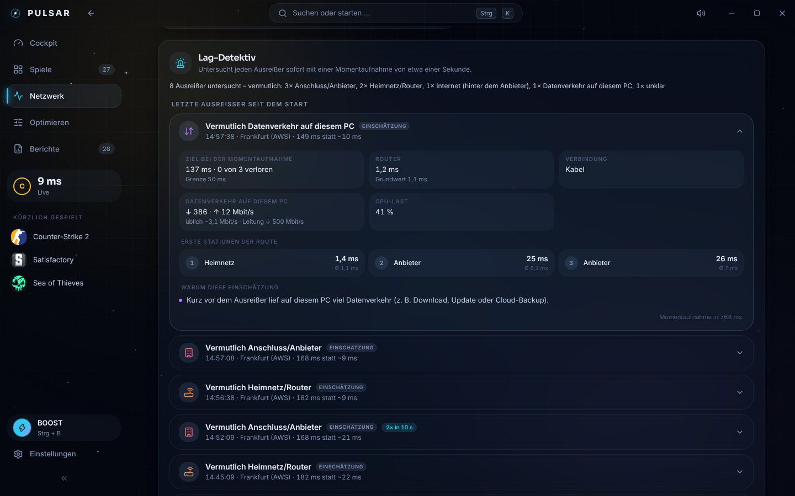
Die letzten 20 Ausreißer seit dem Start von Pulsar, das neueste aufgeklappt. Oben die Zählung, z. B. „8 Ausreißer
untersucht – vermutlich: 3× Anschluss/Anbieter, 2× Heimnetz/Router, …, 1× unklar“. Jedes Ereignis zeigt:
- das Ziel bei der Momentaufnahme (Ping, Verluste, Ausreißer-Grenze), den Router mit seinem üblichen Wert, die Verbindungsart,
- den Datenverkehr auf diesem PC (mit dem üblichen Wert und der Leitung als Bezug) und die CPU-Last,
- die ersten drei Stationen der Route mit Zone (Heimnetz, Anbieter, Internet) und üblichem Wert – stumme Stationen heißen „keine Antwort“,
- **Warum diese Einschätzung** in ganzen Sätzen und einen Verweis zum nächsten Schritt („WLAN-Tab öffnen“ bzw. „„Warum laggt es?“ öffnen“).

Mögliche Ursachen: **WLAN**, **Heimnetz/Router**, **Anschluss/Anbieter** (immer mit „auch möglich: Leitung durch
andere Geräte im Haushalt ausgelastet“), **Internet (hinter dem Anbieter)**, **Datenverkehr auf diesem PC** und **unklar**.
Die üblichen Werte lernt Pulsar in ruhigen Momenten (etwa einmal pro Minute ein paar kleine Pakete).

Ehrlich dazu: Über WLAN lassen sich WLAN und Router nicht sauber trennen – beides heißt dann „WLAN“. Viele Router und
Anbieter beantworten die Anfragen an einzelne Stationen nur nachrangig oder gar nicht. Den Datenverkehr sieht Pulsar
nur als Summe des Adapters, nicht welches Programm ihn verursacht. Pulsar behebt keine Ursache selbst.

### WLAN-Scanner
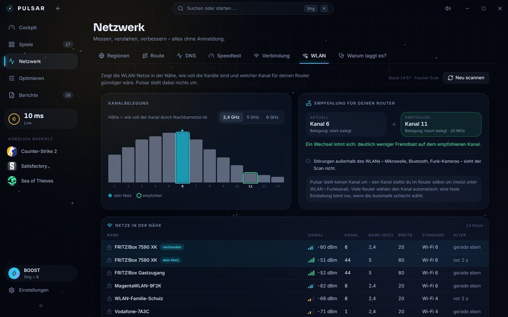
Neuer Tab **WLAN**:
- **Kanalbelegung** je Band (2,4 / 5 / 6 GHz) als Balken – „Höhe = wie voll der Kanal durch Nachbarnetze ist“. Dein Netz ist markiert, der empfohlene Kanal umrandet.
- **Empfehlung für deinen Router:** aktueller Kanal und Belegung → empfohlener Kanal, z. B. „Kanal 6 · stark belegt → Kanal 11 · kaum belegt“, mit dem Satz, ob sich ein Wechsel lohnt. Passt der Kanal schon, steht dort nur „passt“.
- **Netze in der Nähe:** Name, Signal, Kanal, Band, Breite, WLAN-Standard und Alter des Eintrags; dein verbundenes Netz zuerst. Gast- und Hotspot-Netze deines eigenen Routers zählen nicht als fremde Last (erkannt an der Geräteadresse – eine Schätzung).
- Seit Windows 11 24H2 gibt Windows WLAN-Daten nur mit **Standortzugriff** frei. Fehlt er, erklärt die Seite das und hat einen Knopf **Windows-Einstellungen öffnen**.

Ehrlich dazu: Pulsar stellt **keinen Kanal um** – das machst du im Router selbst (meist unter WLAN → Funkkanal).
Viele Router wählen den Kanal automatisch; eine feste Einstellung lohnt nur, wenn die Automatik schlecht wählt.
Die Liste ist eine Momentaufnahme an diesem Ort. Störungen außerhalb des WLANs (Mikrowelle, Bluetooth, Funk-Kameras)
sieht der Scan nicht. Weil ein aktiver Scan auf manchen Treibern kurz den Ping erhöht, scannt Pulsar nie, während ein
Spiel läuft. Den Standortzugriff braucht nur Windows – Pulsar ermittelt keinen Standort und sendet nichts.

### Raum-Scan
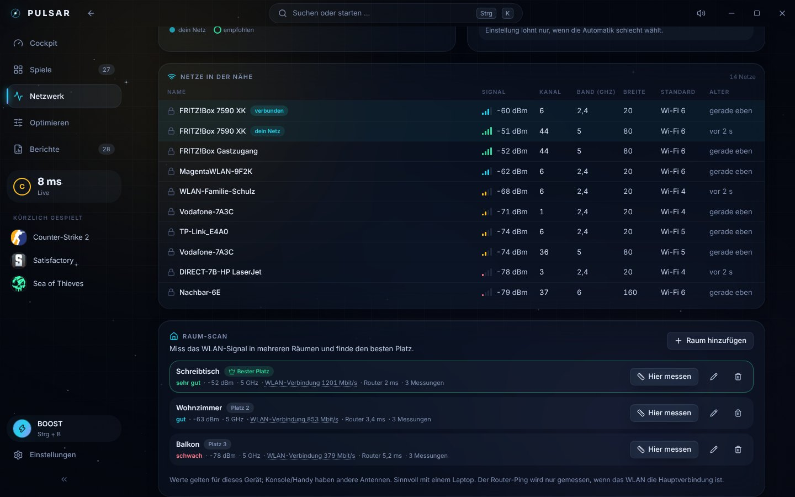
Im selben Tab: Räume anlegen (bis zu 20), mit dem Laptop hingehen und **Hier messen** klicken. Pulsar misst Signal,
Band, die WLAN-Verbindungsrate und – wenn das WLAN die Hauptverbindung ist – den Ping zum Router, und zeigt eine
Rangliste mit **Bester Platz**, „Platz 2“, „Platz 3“ und einer Bewertung (sehr gut … schwach).

Ehrlich dazu: Die Werte gelten für **dieses Gerät** – Konsole und Handy haben andere Antennen. Die WLAN-Verbindungsrate
ist das Tempo zwischen PC und Router, nicht dein Internet-Tempo. Gespeichert wird nur dein eigenes Netz, keine Namen
fremder Netze.

### „Warum laggt es?“
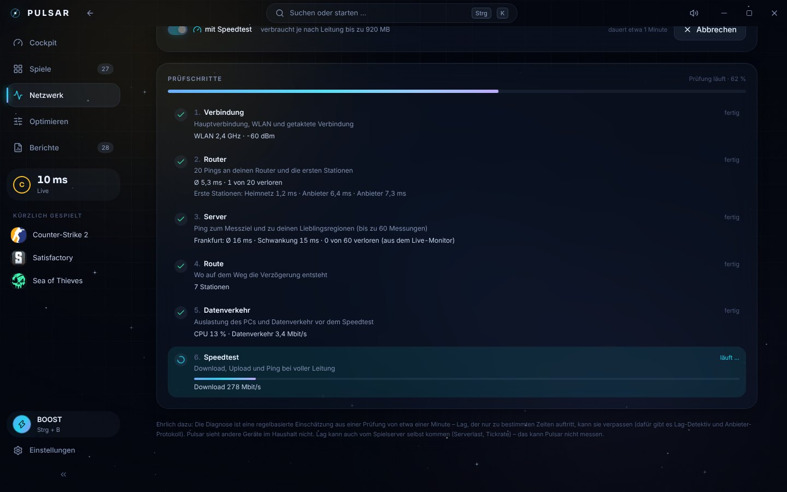
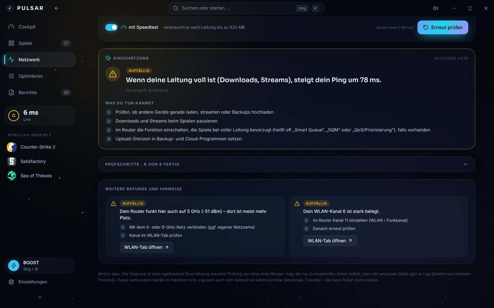
Neuer Tab **Warum laggt es?**: eine geführte Prüfung von etwa einer Minute in sechs Schritten – **Verbindung**
(Kabel/WLAN, getaktete Verbindung), **Router** (20 Pings an den Router und die ersten Stationen), **Server** (Messziel
und Lieblingsregionen), **Route**, **Datenverkehr** (Auslastung des PCs) und auf Wunsch ein **Speedtest** (der Schalter
zeigt, wie viel Datenvolumen er höchstens verbraucht). Danach oben die **Einschätzung** in einem Satz, z. B. „Wenn
deine Leitung voll ist (Downloads, Streams), steigt dein Ping um 78 ms“, mit nummerierten Schritten, was du tun
kannst. Darunter weitere Befunde (z. B. „Dein Router funkt hier auch auf 5 GHz“, „Dein WLAN-Kanal 6 ist stark belegt“)
mit Verweisen wie **WLAN-Tab öffnen**. Die Prüfschritte klappen nach dem Ende ein; die letzte Prüfung bleibt gespeichert.
Einstieg auch im Cockpit (Schnellzugriff) und in der Befehlspalette. Bei einer **getakteten Verbindung** (z. B. Handy-Hotspot,
wenn Windows ihn so kennt) ist der Speedtest zuerst aus.

Unterschied zum Lag-Detektiv: „Datenverkehr auf diesem PC“ bewertet die Diagnose in Ruhe vor dem Speedtest mit einer
festen Grenze von 5 Mbit/s; der Lag-Detektiv dagegen schaut während des Spiels, ob der Verkehr deutlich über deinem
üblichen Wert bzw. nahe an deiner Leitung lag.

Ehrlich dazu: Die Diagnose ist eine regelbasierte Einschätzung aus einer Prüfung von etwa einer Minute – Lag, der nur zu
bestimmten Zeiten auftritt, kann sie verpassen (dafür gibt es Lag-Detektiv und Anbieter-Protokoll). Pulsar sieht andere
Geräte im Haushalt nicht. Lag kann auch vom Spielserver selbst kommen (Serverlast, Tickrate) – das kann Pulsar nicht
messen. Pulsar ändert bei der Prüfung nichts an Windows oder am Router.

---

## Optimieren

Sechs Einstellungen mit ehrlicher Wirkung – jede mit Schalter, Wirkung (hoch/mittel/klein) und **Rückgängig**:
- **Energieplan „Höchstleistung“**
- **Windows-Spielmodus**
- **Game-Bar-Aufnahme aus**
- **Mausbeschleunigung aus**
- **TCP-Pakete sofort senden** („Nagle aus“) – hilft nur Spielen, die TCP nutzen; die meisten Shooter nutzen UDP
- **Netzwerk-Drosselung aus** – Windows bremst das Netzwerk nicht mehr, während Musik oder Videos laufen; bringt meist nur wenig

Die ersten vier gehen ohne Adminrechte. Die zwei Netzwerk-Einstellungen tragen die Hinweise **Windows fragt nach**
(dafür braucht Pulsar kurz Adminrechte – mehrere davon zusammen mit einer einzigen Abfrage) und **Neustart nötig**
(sie wirken erst nach einem Neustart von Windows).
Pulsar sichert vor jeder Änderung den Originalwert und stellt ihn exakt wieder her.
**Alles zurückstellen** oben auf der Seite holt alles auf einmal zurück: den DNS, die zwei Netzwerk-Einstellungen und
alle Schalter mit Sicherung – mit höchstens einer Windows-Abfrage. Sagst du dort **Nein**, ändert sich gar nichts.
**TCP-Pakete sofort senden** gilt immer nur für eine Verbindung: Ist es noch an einer anderen eingestellt (z. B. am
Kabel, jetzt bist du im WLAN), bittet Pulsar, es erst zurückzustellen.
Rechts: Energieplan wählen, DNS-Zwischenspeicher leeren und das **Boost-Profil** (Energieplan, Priorität, DNS – was der BOOST-Knopf macht).

### Netzwerk automatisch optimieren
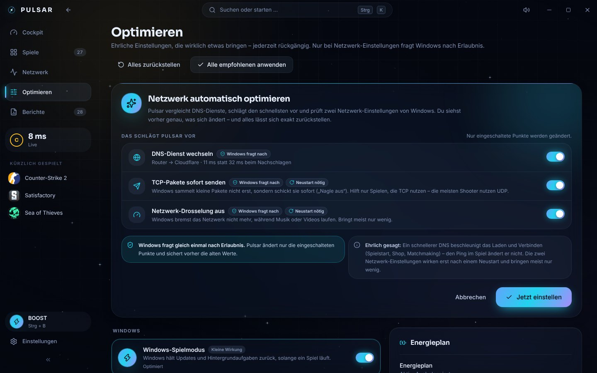
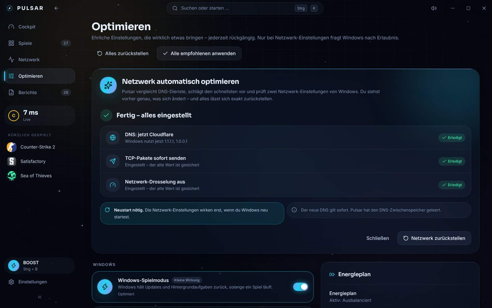
Die Karte oben auf der Seite erledigt DNS und Netzwerk in einem Rutsch:
1. **Jetzt prüfen** vergleicht die DNS-Dienste (etwa 15 Sekunden) und prüft die zwei Netzwerk-Einstellungen. Dabei ändert Pulsar noch nichts.
2. Der Plan **„Das schlägt Pulsar vor“** zeigt jeden Punkt mit Schalter – nur eingeschaltete Punkte werden geändert:
   - **DNS-Dienst wechseln**, z. B. „Router → Cloudflare“ mit den gemessenen Zeiten (neu gegen alt) – nur, wenn ein Dienst deutlich schneller ist (mindestens 15 % und 3 ms), sonst „Dein DNS ist schon schnell – bleibt“. Die Automatik wählt nur Cloudflare, Google, Quad9 oder OpenDNS. Hast du selbst einen anderen bekannten Dienst gewählt (z. B. AdGuard), ist der Wechsel ausgeschaltet.
   - **TCP-Pakete sofort senden** und **Netzwerk-Drosselung aus**, falls sie noch nicht eingestellt sind.
3. **Jetzt einstellen** ändert alles Eingeschaltete mit **einer** Windows-Abfrage. Lehnst du ab, ändert sich nichts.
4. Das Ergebnis zeigt jeden Punkt einzeln (**Erledigt** oder **Nicht geändert** mit Grund) und den Hinweis **Neustart nötig** für die Netzwerk-Einstellungen. Der neue DNS gilt sofort, der DNS-Zwischenspeicher wird geleert.

Danach zeigt die Karte, was Pulsar eingestellt hat – direkt im Ergebnis und auch später. **Netzwerk zurückstellen**
holt DNS und die zwei Netzwerk-Einstellungen exakt zurück – wieder mit einer Windows-Abfrage. Beim Deinstallieren
passiert das automatisch.
Ehrlich dazu: Ein schnellerer DNS beschleunigt das Laden und Verbinden (Spielstart, Shop, Matchmaking), den Ping im Spiel ändert er nicht.
Die zwei Netzwerk-Einstellungen bringen meist nur wenig und wirken erst nach einem Neustart.

---

## Berichte

Jede Spielrunde bekommt einen Bericht: Note, Ping-Verlauf, Ø/Max, Spitzen, Verlust, Messziel, ob geboostet.
Oben: beste und schlechteste Runde und der Trend der letzten Runden. Die Seite hat jetzt vier Bereiche:
**Runden**, **Kalender**, **Anbieter-Protokoll** und **Ausreißer**.

### Ausreißer und ihre Ursachen
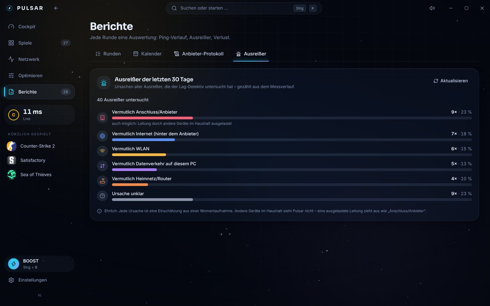
Alle Ausreißer der letzten 30 Tage, die der Lag-Detektiv untersucht hat, nach Ursache gezählt – als Balken mit Anzahl
und Anteil, z. B. „40 Ausreißer untersucht“. „Unklar“ wird immer mitgezählt.

Ehrlich dazu: Jede Ursache ist eine Einschätzung aus einer Momentaufnahme. Andere Geräte im Haushalt sieht Pulsar nicht –
eine ausgelastete Leitung sieht aus wie „Anschluss/Anbieter“.

### Match-Zeitleiste
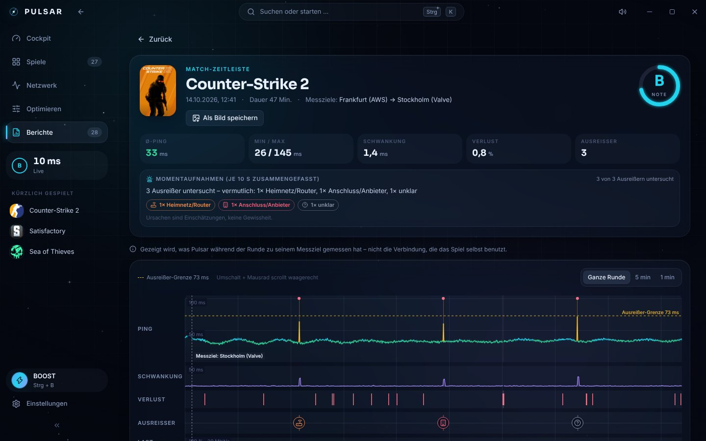
Klick auf eine Runde öffnet ihre Zeitleiste: Kopf mit Note, Ø-Ping, Min/Max, Schwankung, Verlust und Ausreißern, dazu
die **Momentaufnahmen (je 10 s zusammengefasst)** mit den Ursachen. Darunter Spuren für **Ping**, **Schwankung**,
**Verlust**, **Ausreißer** (mit Ursachen-Symbol) und **Last** (CPU, empfangener und gesendeter Datenverkehr). Ansicht „Ganze Runde“, „5 min“
oder „1 min“; mit Umschalt + Mausrad scrollst du waagerecht. Wechselt das Messziel während der Runde, steht das in der Spur.

Ehrlich dazu: Die Zeitleiste zeigt, was Pulsar während der Runde zu **seinem Messziel** gemessen hat – nicht die
Verbindung, die das Spiel selbst benutzt. Rohdaten gibt es nur für die 50 neuesten Runden (höchstens 90 Tage) und nur,
solange der Monitor lief; ältere Berichte zeigen die verdichtete Kurve.

### Bildkarte
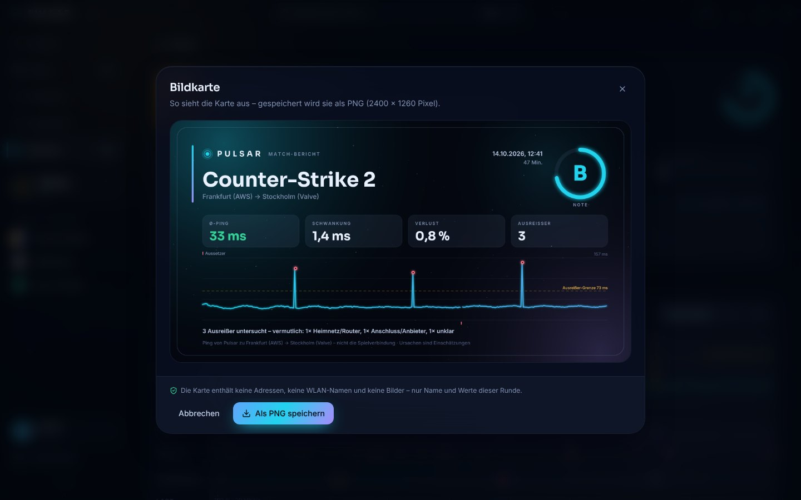
**Als Bild speichern** in der Zeitleiste zeigt erst eine Vorschau und speichert die Runde dann als PNG
(2400 × 1260 Pixel) – zum Teilen mit Freunden oder im Discord. Auf der Karte: Spiel, Datum, Dauer, Note, Ø-Ping,
Schwankung, Verlust, Ausreißer, die Ping-Kurve und die Ursachen-Zählung.

Ehrlich dazu: Die Karte enthält keine Adressen, keine WLAN-Namen und keine Bilder – nur Name und Werte dieser Runde. Unten
steht klein, dass es Pulsars Ping zum Messziel ist und die Ursachen Einschätzungen sind.

### Pulsar-Kalender
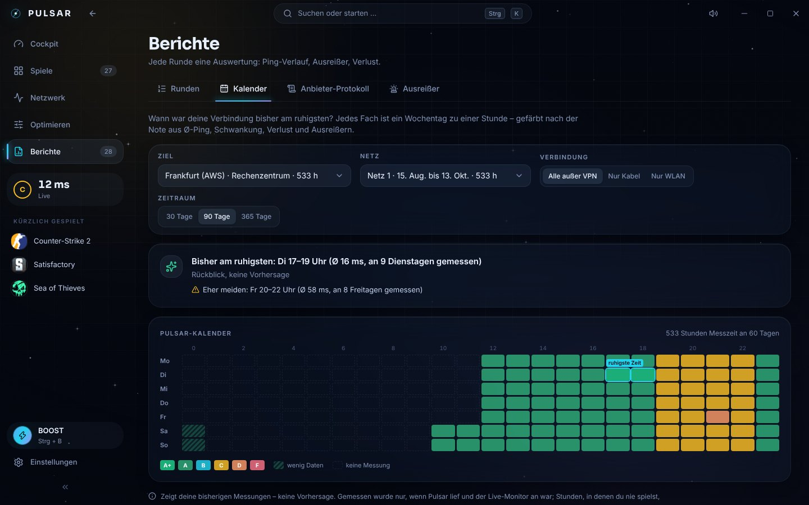
Wann war deine Verbindung bisher am ruhigsten? Jedes Fach ist ein Wochentag zu einer Stunde, gefärbt nach der Note aus
Ø-Ping, Schwankung, Verlust und Ausreißern. Filter: Ziel, Netz („Netz 1“, „Netz 2“ …), Verbindungsart und Zeitraum
(30/90/365 Tage). Gibt es genug Daten (mindestens 20 Stunden Messzeit an 7 Tagen) und einen deutlichen Unterschied,
nennt Pulsar die ruhigste Zeit, z. B. „Bisher am ruhigsten: Di 17–19 Uhr“, und eine Zeit, die du eher meiden solltest.
Sonst steht dort ehrlich „Zu wenig Daten“ oder „Kein deutlicher Unterschied“.

Ehrlich dazu: Der Kalender ist ein **Rückblick, keine Vorhersage**. Gemessen wurde nur, wenn Pulsar lief – Stunden, in
denen du nie spielst, bleiben leer. Kabel, WLAN, VPN und verschiedene Netze werden getrennt, weil sie sich nicht vergleichen lassen.

### Anbieter-Protokoll
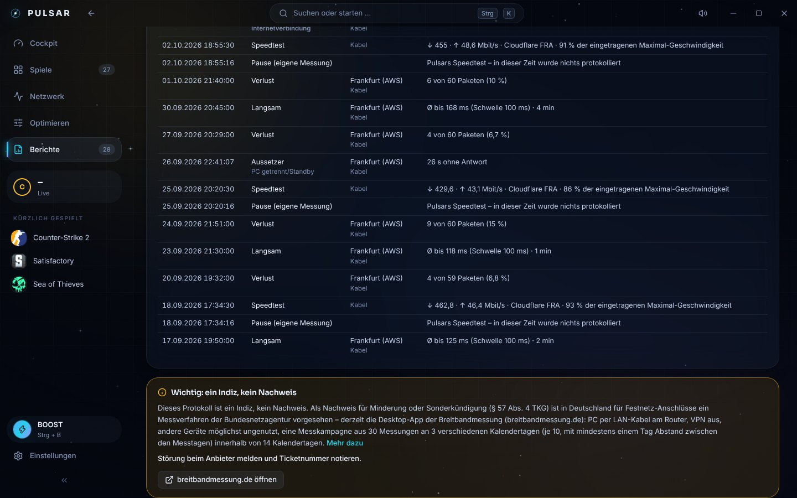
Aussetzer, Paketverlust, langsame Minuten und Speedtests mit Uhrzeit – für ein Netz und einen Zeitraum von 7, 30
oder 90 Tagen. Oben die Datenbasis (Messzeit, Zeitzone, Messziele, WLAN-Anteil), Kennzahlen („Aussetzer Internet“,
„Andere Aussetzer“, „Zeiten mit Paketverlust“, „Langsame Minuten“, „Speedtests“), Messstunden je Tag und die Liste aller
Ereignisse. **Bericht speichern (HTML)** (zum Drucken) oder **Als CSV speichern**. Nur Aussetzer, bei denen auch zwei
unabhängige Internet-Adressen nicht antworteten, heißen „Aussetzer der Internetverbindung“; Aussetzer am PC (Standby,
Kabel gezogen, WLAN-Wechsel, VPN) und nur des Messziels stehen getrennt. Während Pulsars eigenem Speedtest bzw. WLAN-Scan
wird nichts protokolliert („Pause (eigene Messung)“). Hast du deine Vertragswerte eingetragen, steht bei Speedtests
zusätzlich der Anteil davon – als Zahl, ohne Bewertung.

Ehrlich dazu: Das Protokoll ist ein **Indiz, kein Nachweis**, und Pulsar bewertet nichts juristisch. Für Ansprüche
gegenüber dem Anbieter zählt in Deutschland bei Festnetz-Anschlüssen die **Breitbandmessung der Bundesnetzagentur** –
der gelbe Kasten erklärt das und öffnet breitbandmessung.de. Ein Protokoll per WLAN ist ein schwaches Indiz für den Anschluss.

---

## Einstellungen

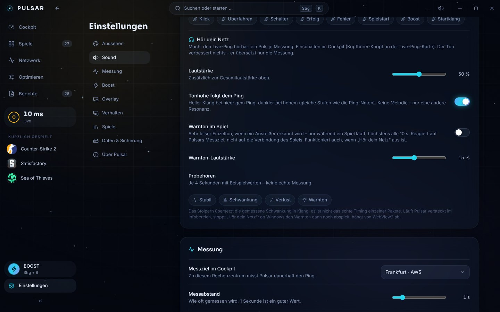

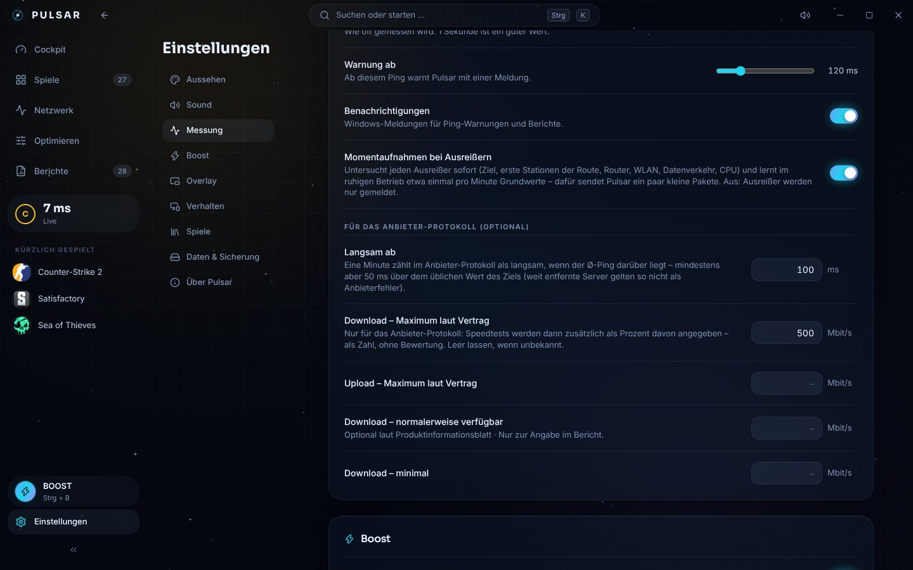

- **Aussehen:** 4 Themes (Pulsar, Glut, Toxic, Frost) mit Lichtkreis-Übergang, eigene Akzentfarbe, Animationen (voll/verringert/aus), Startanimation, Sprache.
- **Sound:** alle Klänge werden live erzeugt (keine Dateien); Lautstärke, Hover-Töne, Probehören.
  Unterabschnitt **Hör dein Netz**: Lautstärke, „Tonhöhe folgt dem Ping“, **Warnton im Spiel** (Standard aus – ein sehr
  leiser Einzelton bei einem Ausreißer, nur während ein Spiel läuft, höchstens alle 10 s), Warnton-Lautstärke und
  **Probehören** („Stabil“, „Schwankung“, „Verlust“, „Warnton“ – je 4 Sekunden Beispielwerte, keine echte Messung).
- **Messung:** Messziel im Cockpit, Messabstand, Warnschwelle, Windows-Benachrichtigungen,
  **Momentaufnahmen bei Ausreißern** (Lag-Detektiv; aus = Ausreißer werden nur gemeldet, keine zusätzlichen Pakete) und
  **Für das Anbieter-Protokoll (optional)**: „Langsam ab … ms“ und deine Vertragswerte (Download/Upload „Maximum laut
  Vertrag“, optional „normalerweise verfügbar“ und „minimal“ aus dem Produktinformationsblatt).
- **Boost:** automatisch boosten, sobald ein Spiel startet.
- **Overlay:** an/aus, Tastenkürzel (aufnehmen), Ecke, Deckkraft, angezeigte Werte.
- **Verhalten:** Schließen minimiert in den Infobereich, mit Windows starten.
- **Spiele:** beim Start nach neuen Spielen suchen, SteamGridDB-Schlüssel (freiwillig).
- **Daten & Sicherung:** automatische Backups (täglich, die letzten 10) wiederherstellen, jetzt sichern, Bild-Zwischenspeicher leeren.
  **Messverlauf dauerhaft speichern** (Ping-Statistik je Stunde für 400 Tage, Ereignisse bis 365 Tage, Rohdaten der
  letzten 50 Runden für 90 Tage – nur lokal, nichts verlässt den PC) und **Messverlauf löschen** (mit Rückfrage; die
  Berichte bleiben, ältere Sicherungen enthalten den Verlauf noch, bis sie ersetzt werden).

Ehrlich dazu: Der Messverlauf ist nur so vollständig wie die Zeit, in der Pulsar lief und gemessen hat – Lücken bleiben
Lücken. Er braucht typisch 2–6 MB, im ungünstigsten Fall etwa 15 MB; die Sicherungen sind Kopien der ganzen Datei.
- **Über Pulsar:** Version, Update prüfen und **Jetzt aktualisieren**, Datenordner, Tastenkürzel.

---

## Weitere Funktionen

### Befehlspalette

`Strg + K` oder `/`: Spiele starten, Seiten öffnen, Boost, Speedtest, Route, Netzwerk automatisch optimieren, Theme wechseln – alles per Tastatur.
Neu: **Warum laggt es?**, **WLAN-Scanner**, **Anbieter-Protokoll** und **Kalender** springen direkt zur passenden Seite.

### Spiele automatisch finden

Steam, Epic, GOG, Startmenü und eigene Ordner. Radar-Animation, Doppelte werden erkannt, Vorauswahl der neuen Spiele.

### Manuell hinzufügen

Programm, Link (z. B. `steam://`) oder Verknüpfung – mit Startparametern.

### Boost & Spielen (Start-Ritual)

Cover zoomt ins Zentrum, Lichtringe, Partikel – währenddessen wird der Boost aktiviert und das Spiel gestartet. Pulsar misst mit und erstellt danach den Bericht.

### Themes

### Overlay im Spiel

`Alt + Shift + P`: kleines, durchsichtiges Fenster mit Note, Ping, Schwankung, Verlust, CPU/GPU/RAM und Uhr – immer im Vordergrund, verschiebbar, Ecke und Deckkraft einstellbar. Funktioniert im Fenster- und randlosen Modus (nicht im exklusiven Vollbild).

### Infobereich (Tray)
Pulsar läuft neben der Uhr weiter: Boost an/aus, Speedtest, zuletzt gespielte Spiele starten, Fenster öffnen.

---

## Der Installer

Das Setup ist wie ein **Radioteleskop** gebaut: links ein Schirm mit dem Neutronenstern, rechts das Bedienfeld,
unten die Himmelskoordinaten des Referenz-Pulsars. Eine Akzentfarbe, Haarlinien, Skalen, Messwerte in Monospace –
kein Glas, keine Farbverläufe, kein Konfetti.

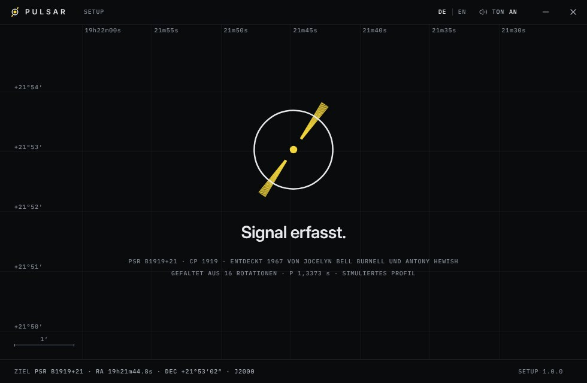

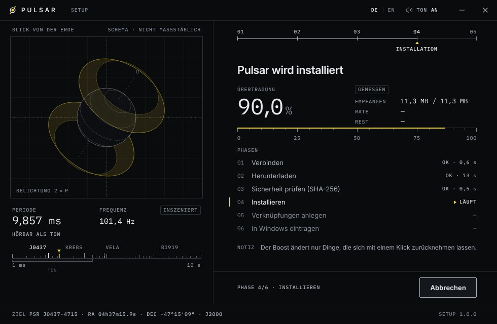

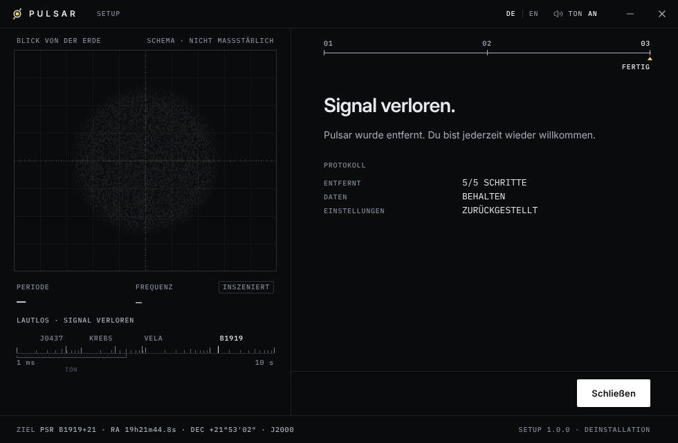

- **Intro:** Rauschen, ein Frequenzregler sucht und rastet auf **PSR B1919+21** ein (der erste Pulsar, 1967 entdeckt von
  Jocelyn Bell Burnell und Antony Hewish, Periode 1,3373 s). Zwei Pulse kommen in Echtzeit, der Rest des gestapelten
  Pulsprofils im beschrifteten Zeitraffer; dann falten sich die Linien zum Pulsar-Zeichen: „Signal erfasst.“
  Mit Klick oder Taste überspringbar. Das Profil ist **simuliert** und so beschriftet.
- **Installation:** Der Fortschritt treibt die Drehung des Sterns an – vom Takt von B1919+21 über Vela (89 ms) und
  den Krebsnebel-Pulsar (33,7 ms) bis zum Millisekunden-Pulsar J0437−4715 (5,76 ms). Man hört, wie aus einzelnen
  Klicks ein Knattern, ein Schnarren und am Ende ein Ton wird. Die Drehung ist **Inszenierung** (so beschriftet);
  Bytes, Rate und Restzeit rechts sind **gemessen**.
- **Fertig:** Ein Stroboskop friert den Stern ein, die Strahlen werden zum Zeichen, der Ton löst sich in seine
  Obertöne auf: „Signal steht.“ **Deinstallieren** läuft rückwärts – der Stern wird langsamer, der Ton zerfällt in
  Klicks und Rauschen: „Signal verloren.“
- **Klang:** „Pulsar-Sonifikation“ – nur Web Audio, keine Dateien, keine Melodien (Puls-Klicks, Rauschen, fallende
  Dispersions-Sweeps, ein Akkord aus den Obertönen des Endtons). Leise Grundlautstärke, Knopf **Ton** oben bzw.
  Taste **M**. Die Einstellung „Bewegung reduzieren“ von Windows wird beachtet (Standbilder, Ton bleibt).
- **Willkommen** → **Speicherort** (freier Platz, Adminrechte nur wenn nötig) → **Optionen** (Desktop, Startmenü, Autostart, danach starten) → **Installation**.
- **Speicherort:** Vorgeschlagen ist dein Benutzerordner (ohne Adminrechte). Wer DNS oder die zwei Netzwerk-Einstellungen von Pulsar ändern lässt, wählt mit **Ändern** besser `C:\Program Files` – dort können andere Programme unter deinem Konto die Pulsar-Dateien nicht verändern. Das Setup fragt dafür einmal nach Adminrechten.
- Download mit gemessenem Fortschritt, Tempo, Restzeit, Dauer jeder Phase und wechselnden Notizen; SHA-256-Prüfung; Verknüpfungen; Eintrag in „Apps & Features“.
- Bricht das Internet ab: **Erneut versuchen** setzt den Download an der Stelle fort.
- Ist Pulsar schon installiert: **Aktualisieren/Reparieren** oder **Deinstallieren** (mit „Meine Daten behalten“). Vor dem Löschen stellt der Deinstaller alle Windows-Einstellungen zurück, die Pulsar geändert hat (DNS und Optimierungen) – braucht das Adminrechte, fragt Windows einmal nach.
- Klappt das Zurückstellen nicht ganz (z. B. Windows-Abfrage abgelehnt), wird Pulsar trotzdem entfernt, aber deine Pulsar-Daten mit den Sicherungen bleiben **immer** erhalten – auch ohne „Meine Daten behalten“. Die Fertig-Seite sagt das in einem gelben Hinweis und erklärt, wie du es nachholst (neu installieren → **Optimieren** → **Alles zurückstellen**).
