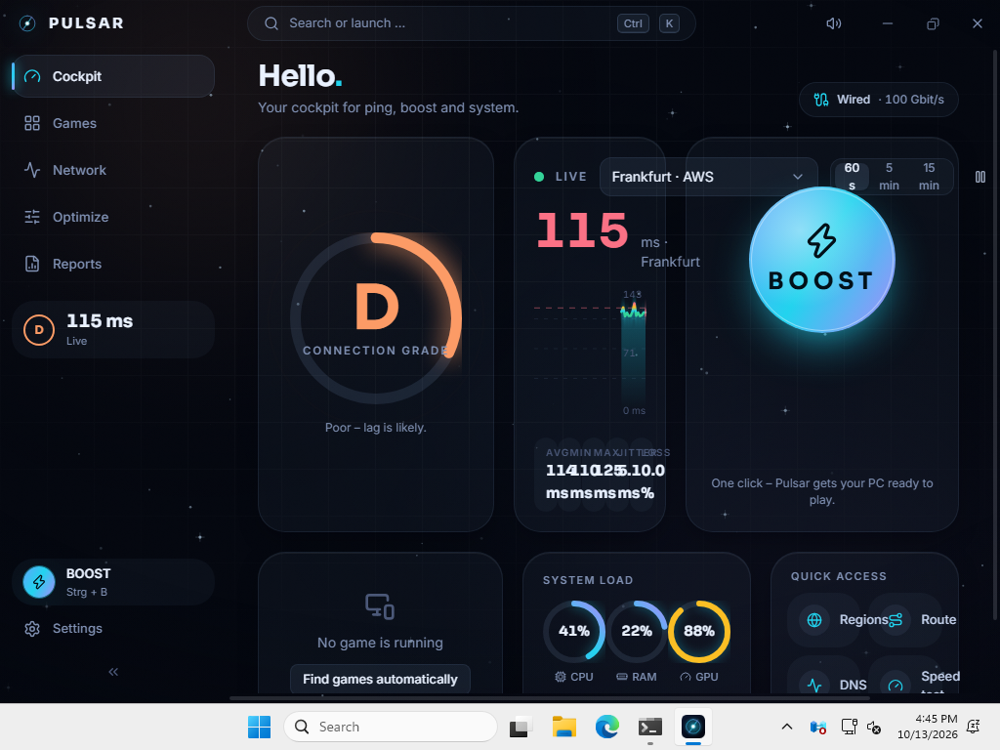
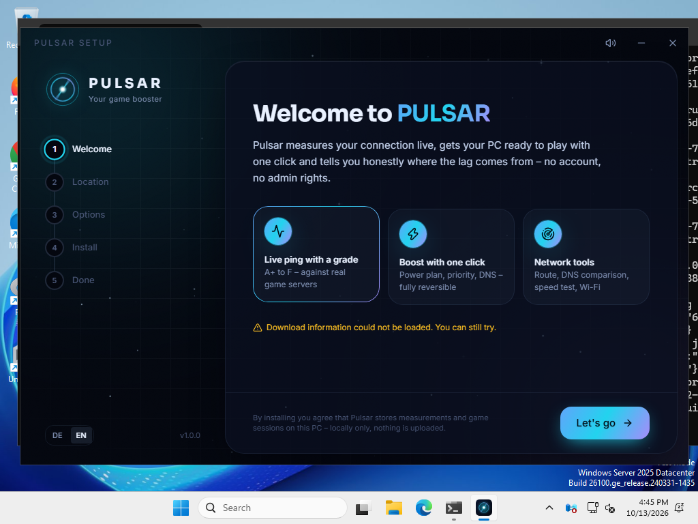

# PULSAR – Testbericht

Ehrliche Übersicht: Was wurde wie geprüft, was läuft automatisch auf einem echten Windows-Rechner (GitHub-CI),
und was konnte bisher nicht geprüft werden.

## 1. Automatisch bei jedem Push (GitHub Actions, Windows)

Workflow `.github/workflows/windows.yml` auf `windows-latest`:

| Schritt | Was wird geprüft |
|---|---|
| Typprüfung | `tsc` für App und Installer – 0 Fehler |
| Oberflächen-Tests | `vitest`: Verbindungsnote, Ping-Statistik (Jitter, Verlust, Spitzen, Verdichtung), Bufferbloat-Note, Suche, Doppelte, Einstellungen-Reparatur, Spielserver-Erkennung, Übersetzungen (Schlüssel + Platzhalter DE/EN) |
| Rust-Tests | `cargo test` für App und Installer auf Windows: Datenbank, Scanner, Bilder, Netzwerk-Logik (Statistik, DNS-Pakete, SDR-JSON, Regionen, Routen-Zonen), Optimierer (powercfg-Parsing, Registry-Sicherungen, Tweaks an/aus/rückgängig, Boost start/stop), Installer (Manifest, Pfade, Prüfsummen) |
| Bauen | `npm run build:all` → `Pulsar.exe`, `Pulsar-Setup.exe`, `latest.json`, `SHA256SUMS.txt` |
| App-Starttest | Startet `Pulsar.exe`, wartet 18 s, zwei Screenshots, prüft, dass sie nicht abstürzt |
| Installer-Starttest | Startet `Pulsar-Setup.exe`, Screenshot nach 9 s |
| Installer-Selbsttest | `--selftest`: lädt die App von einem lokalen Testserver, prüft SHA-256, installiert, legt Verknüpfungen und den Eintrag in „Apps & Features“ an, deinstalliert wieder |
| App-Selbsttest | `Pulsar.exe --selftest`: Steam-Scan (nachgebaute Steam-Installation), Startmenü/Epic/GOG-Scan, Steam-Bilder (Cover, Hintergrund, Logo, Icon), Bilder per Name, Exe-Icon, Icon aus Ordner, PC-Auslastung, **Regionenliste, TCP-Ping, ICMP-Ping, Regionen-Ping, CS2-Spielserver (Valve-API), DNS-Vergleich, aktueller DNS, Adapter, WLAN, Route, Tweaks lesen, Energiepläne, Boost an → Boost aus (alter Energieplan muss zurück sein)**, Programm starten, „läuft gerade“ erkennen, beenden, Spielzeit gespeichert |
| Release | Nur wenn alles grün ist: Dateien ins Release `pulsar-latest` |

Ergebnis des letzten Laufs: siehe `https://github.com/georghatzmann-bit/vanity-/actions` (Eintrag „Windows Build & Test“) –
die Selbsttest-Berichte (`selftest.json`, `app-selftest.json`) und Screenshots liegen im Artefakt `pulsar-windows-<version>`.

Echte Screenshots vom Windows-Rechner der CI (1024×768, englische Systemsprache):

### Was der App-Selbsttest auf dem GitHub-Windows-Rechner wirklich gemessen hat (13.10.2026)

| Prüfung | Ergebnis |
|---|---|
| Steam-Scan | Portal 2 gefunden (nachgebaute Steam-Installation) |
| Startmenü/Epic/GOG-Scan | 46 Einträge (7-Zip, Firefox, …) |
| Steam-Bilder | Cover, Hintergrund, Logo, Icon geladen; Bilder per Name: Hades II → Steam-ID 1145350 |
| Exe-Icon, Icon aus Ordner | ok |
| PC-Auslastung | CPU 40 %, RAM 16 GB, GPU-Wert vorhanden |
| Regionen | 29 Regionen, alle 7 Erdteile |
| TCP-Ping (1.1.1.1:443) | Ø 19 ms, Schwankung 0,7 ms, 0 % Verlust |
| ICMP-Ping | 100 % Verlust – die Azure-Firewall des Runners blockt ICMP; der Aufruf bleibt sauber (kein Absturz) |
| Regionen-Ping | 3/3 Regionen geantwortet |
| Echte Spielserver (CS2) | 44 Valve-Standorte live von der Steam-API geladen |
| DNS-Vergleich | 5/7 Dienste geantwortet (UDP 53 teilweise geblockt) |
| Adapter | im ersten Lauf 0 (Hyper-V-Adapter wurde als „virtuell“ aussortiert) → behoben: in VMs zählt der virtuelle Adapter mit Gateway |
| WLAN | kein WLAN (erwartet) |
| Route | 8 Stationen, Ziel nicht erreicht (ICMP-TTL-Antworten geblockt) – Aufruf sauber |
| Tweaks lesen | powerPlan=on, gameMode=unknown, gameDvr=unknown (Werte auf frischem Windows nicht vorhanden), mouseAccel=off |
| Energiepläne | Balanced, High performance (aktiv), Power saver |
| Boost an | Energieplan ok, Priorität „kein Spiel“ (ehrlich gemeldet), DNS geleert |
| Boost aus | Energieplan vorher = nachher (8c5e7fda-…) – Rückstellung funktioniert |
| Starten / erkannt / beenden / Spielzeit | PING.EXE gestartet, nach 0,5 s erkannt, beendet, 13 s in 1 Sitzung gespeichert |

## 2. Lokal geprüft (Linux-Entwicklungsumgebung)

| Was | Ergebnis |
|---|---|
| `npm run typecheck` (App + Installer) | 0 Fehler |
| `npm test` | 20 Tests bestanden |
| `cargo test` App (Linux) | 143 Tests bestanden (Datenbank, Scanner, Bilder, Optimierer 38, Netzwerk 41 – darunter DNS-Pakete gegen einen lokalen UDP-Server und TCP-Ping gegen lokale Ports) |
| `cargo test` Installer (Linux) | bestanden |
| `cargo xwin check --target x86_64-pc-windows-msvc` | Windows-Code (ICMP, IP Helper, WLAN, Registry, powercfg) kompiliert ohne Fehler |
| Browser-Rundgang App (Playwright, Demo-Backend) | Alle Seiten (Cockpit, Spiele, Spiel, Netzwerk ×5, Optimieren, Berichte, Einstellungen, Palette, Boost, 4 Themes, Overlay) ohne Konsolenfehler; 33 Screenshots |
| Browser-Rundgang Installer (Playwright, Demo-Backend) | Intro, Willkommen, Ordner, Optionen, Download, Fertig, Fehler + Fortsetzen, Wartung, Deinstallation ohne Konsolenfehler; 13 Screenshots |

Dabei gefunden und behoben: eine Endlosschleife durch Store-Selektoren, die bei jedem Rendern neue Listen erzeugten
(Spiel-Seite, Seitenleiste), und ein verschachtelter Button im Cockpit.

## 3. Nicht geprüft (ehrlich)

- **Echte Windows-Laufzeit außerhalb der CI:** Ob `IcmpSendEcho` in deiner Firewall durchkommt, wie `powercfg` auf
  deinem Windows antwortet (Sprache/Codepage), ob dein Anti-Cheat die Priorität zulässt – das zeigt sich erst auf
  deinem PC. Alle diese Stellen melden Fehler als Text statt abzustürzen.
- **WLAN:** Der GitHub-Rechner hat kein WLAN. Der WLAN-Code wird dort nur „sauber antworten“ geprüft, nicht mit echten Werten.
- **Overlay über Vollbild-Spielen:** Funktioniert nur im Fenster-/randlosen Modus (technische Grenze ohne Grafik-Hook).
- **Speedtest-Zahlen:** hängen vom Cloudflare-Server und deiner Leitung ab; die Bufferbloat-Note ist eine Einschätzung, keine Labormessung.
- **Windows-Benachrichtigungen und Autostart** wurden nur per Code geprüft, nicht per Klick.

## 4. Grenzen, die Pulsar offen nennt

- Kein eigenes Servernetz → kein „Ping-Umleiten“.
- Kein FPS-Zähler (kein Grafik-Hook, kein Anti-Cheat-Risiko).
- Keine Adminrechte → keine TCP-Stack-Tweaks, keine Dienste. Dafür: nichts, was dein System „kaputtoptimiert“.
